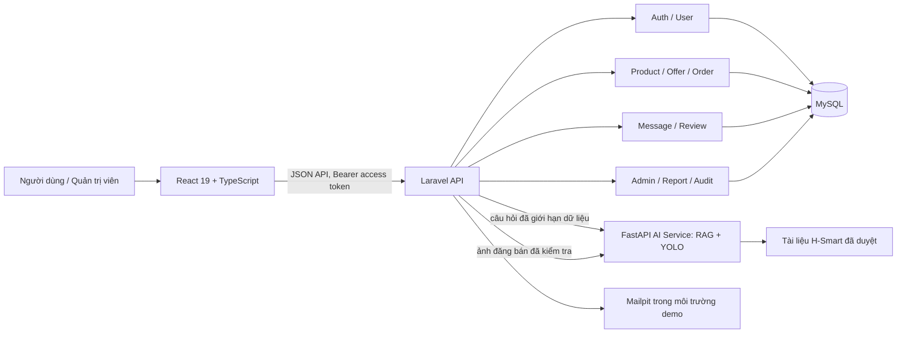

# Kiến trúc và chức năng đã triển khai của H-Smart

Tài liệu này mô tả trạng thái mã nguồn đang có trong repository, dùng làm tài liệu nền để viết báo cáo đồ án. Nội dung phân biệt chức năng đã chạy với ý tưởng còn nằm trong tài liệu thiết kế.

**Cập nhật:** 26/10/2026
**Phạm vi:** ứng dụng chợ đồ cũ dành cho sinh viên, gồm frontend, API backend, cơ sở dữ liệu và môi trường Docker.

## 1. Giới thiệu hệ thống

H-Smart hỗ trợ sinh viên đăng tin, tìm và lưu sản phẩm, trả giá, đặt hàng, thanh toán qua VNPay, trao đổi tin nhắn và đánh giá sau khi giao dịch hoàn tất. Quản trị viên có thể kiểm duyệt tin, xử lý báo cáo, hỗ trợ tra cứu đơn hàng, quản lý tài khoản và danh mục.

Ứng dụng dùng **modular monolith** cho nghiệp vụ: frontend React gọi backend Laravel, các module nghiệp vụ dùng chung MySQL. Python AI Service là dịch vụ riêng chạy RAG hỏi đáp và Computer Vision; Laravel giữ quyền xác thực và kiểm soát dữ liệu vào/ra.

## 2. Công nghệ và cấu trúc triển khai

| Thành phần | Công nghệ | Trách nhiệm |
| --- | --- | --- |
| Frontend | React 19, TypeScript, Vite, Tailwind CSS | Giao diện, điều hướng, biểu mẫu và gọi API |
| Backend | PHP, Laravel | Xác thực, quy tắc nghiệp vụ, phân quyền, API và migration |
| Cơ sở dữ liệu | MySQL 8 | Lưu tài khoản, sản phẩm, đơn hàng và dữ liệu nghiệp vụ |
| AI | Python, FastAPI, Ultralytics YOLO, Gemini API | Hỏi đáp trên tài liệu đã duyệt; nhận diện vật thể và tạo mô tả nháp từ dữ kiện sản phẩm |
| Môi trường phát triển | Docker Compose | Khởi chạy frontend, backend, Python AI, MySQL, phpMyAdmin và Mailpit |
| Kiểm thử | PHPUnit/Laravel feature tests, TypeScript build | Kiểm tra luồng API và biên dịch frontend |

Các tệp triển khai chính là `compose.yaml`, `backend/Dockerfile` và `frontend/Dockerfile`. Laravel tự chạy migration khi khởi động backend. Seeder tạo tài khoản quản trị và dữ liệu sản phẩm demo trong môi trường đồ án.

## 3. Frontend

### 3.1 Tổ chức giao diện

Frontend nằm trong `frontend/src`. `App.tsx` quản lý trạng thái phiên đăng nhập và điều hướng đường dẫn bằng History API của trình duyệt. Khi đường dẫn thay đổi, giao diện cuộn về đầu trang. Các màn hình nghiệp vụ là những page/component riêng; những yêu cầu HTTP được gom theo nhóm API như `productApi.ts` và `adminApi.ts`.

Navbar hiển thị các thao tác khác nhau theo trạng thái đăng nhập và vai trò. Thành viên có các lối vào mua sắm, tin nhắn, đơn hàng, yêu thích, hồ sơ và đăng bán. Tài khoản admin có thêm lối vào trang quản trị.

### 3.2 Màn hình và đường dẫn chính

| Đường dẫn / màn hình | Chức năng |
| --- | --- |
| `/` | Trang chủ, banner, nhóm danh mục và sản phẩm gợi ý |
| `/login`, `/register` | Đăng nhập và tạo tài khoản bằng email |
| `/verify-email` | Hoàn tất xác thực email qua liên kết gửi trong email |
| `/forgot-password`, `/reset-password` | Yêu cầu và hoàn tất đặt lại mật khẩu |
| `/products` | Duyệt, tìm kiếm, lọc và sắp xếp sản phẩm |
| `/products/{id}` | Chi tiết sản phẩm, người bán, đánh giá, đề nghị giá, nhắn tin và báo cáo |
| `/sell`, `/products/{id}/edit` | Tạo và chỉnh sửa tin đăng |
| `/me/products` | Xem và quản lý tin của tài khoản hiện tại |
| `/me/favorites` | Xem danh sách sản phẩm yêu thích |
| `/me/offers` | Xem và xử lý các đề nghị mua bán liên quan đến tài khoản |
| `/orders/create`, `/me/orders` | Tạo đơn và theo dõi đơn mua/bán |
| `/me/messages` | Trao đổi tin nhắn với người mua hoặc người bán |
| `/me/notifications` | Xem thông báo, đánh dấu đã đọc; navbar hiển thị số chưa đọc |
| `/assistant` | Hỏi đáp cách sử dụng H-Smart và xem lịch sử chat |
| `/me/profile` | Cập nhật hồ sơ và địa chỉ nhận hàng mặc định |
| `/admin` | Dashboard quản trị và các công cụ quản lý hệ thống |

### 3.3 Chức năng frontend theo nghiệp vụ

**Tài khoản và xác thực**

- Biểu mẫu đăng ký nhận email, mật khẩu và tên tùy chọn; frontend kiểm tra trường bắt buộc và xác nhận mật khẩu.
- Màn hình xác thực email thông báo kết quả; người dùng có thể đăng nhập sau khi email được xác thực.
- Có luồng đăng nhập, gửi lại email xác thực, quên mật khẩu, đặt lại mật khẩu, đổi mật khẩu và đăng xuất.
- Thông báo lỗi và kết quả thành công được hiển thị ngay tại màn hình thao tác.

**Khám phá và quản lý sản phẩm**

- Trang chủ trình bày danh mục và sản phẩm đang bán.
- Danh sách sản phẩm hỗ trợ tìm theo từ khóa, lọc danh mục, tình trạng, khoảng giá và sắp xếp theo thời gian hoặc giá.
- Thẻ sản phẩm tóm tắt ảnh, tên, giá, danh mục, tình trạng và trạng thái yêu thích.
- Trang chi tiết hiển thị ảnh, mô tả, giá, tình trạng, danh mục, thông tin người bán, đánh giá và sản phẩm gợi ý.
- Người đăng có màn hình tạo/sửa tin, thêm thông tin thương lượng, giá tối thiểu, danh mục, tình trạng và ảnh.
- Tại màn hình đăng bán, người dùng có thể gửi ảnh đầu tiên qua Laravel để YOLO nhận diện vật thể; người dùng xem nhãn và chủ động chọn dùng làm tên sản phẩm. AI không tự đặt giá, tình trạng hoặc đăng tin.
- Nút tạo mô tả gửi thông tin người bán nhập và ảnh tùy chọn đến Laravel. AI Service chạy YOLO trong nội bộ; Gemini nhận nhãn YOLO cùng thông tin sản phẩm để tạo bản nháp. Bản nháp được đưa vào ô mô tả để người bán xem/sửa; chỉ thao tác gửi form mới lưu sản phẩm.
- Khu vực sản phẩm của tôi cho phép theo dõi các tin và thao tác quản lý phù hợp với trạng thái.

**Đề nghị và mua bán**

- Người mua gửi giá đề nghị trong phạm vi giá cho phép; người bán xem, chấp nhận hoặc từ chối; người mua có thể hủy đề nghị còn hiệu lực.
- Khi đề nghị được chấp nhận, người mua có thể tạo đơn và cung cấp địa chỉ nhận hàng.
- Trang đơn hàng trình bày trạng thái và thông tin vận chuyển; thao tác hiển thị theo vai trò mua/bán và trạng thái đơn.
- Thanh toán chuyển người mua sang cổng VNPay; trạng thái đơn được xác nhận từ IPN đã kiểm tra chữ ký và số tiền.

**Giao tiếp và đánh giá**

- Trang tin nhắn hỗ trợ trao đổi văn bản giữa hai bên liên quan đến tin đăng.
- Danh sách thông báo ghi nhận tin nhắn mới, đề nghị giá và các mốc đơn hàng; navbar tải số chưa đọc khi mở trang, đổi màn hình hoặc quay lại tab. Người dùng có thể đánh dấu từng thông báo hoặc tất cả đã đọc. Bản hiện tại tải theo yêu cầu, chưa dùng kết nối thời gian thực.
- Người mua có thể gửi đánh giá khi giao dịch đủ điều kiện hoàn tất; trang sản phẩm hiển thị điểm và số đánh giá.
- Nút báo cáo tại chi tiết sản phẩm cho phép gửi lý do và thông tin bổ sung, chọn đối tượng là sản phẩm hoặc người bán.

**Hồ sơ và quản trị**

- Hồ sơ cho phép xem/sửa tên, số điện thoại và địa chỉ mặc định.
- Dashboard admin có tổng quan số người dùng, tin đăng, đơn hàng, sản phẩm đã ẩn và báo cáo đang chờ.
- Mục báo cáo hiển thị nội dung bị báo cáo, lý do, chi tiết, người gửi và các thao tác ẩn tin, khóa tài khoản hoặc bỏ qua.
- Mục giao dịch tìm theo mã đơn, mã vận đơn, sản phẩm hoặc email; hỗ trợ lọc sáu trạng thái và hiển thị người mua, người bán, vận chuyển, tổng tiền.
- Mục lịch sử thao tác hiển thị người quản trị, hành động, đối tượng, mã đối tượng và thời điểm.
- Mục quản lý hệ thống giữ các công cụ đã có: duyệt/ẩn sản phẩm, quản lý tài khoản và quản lý danh mục.

**Trợ lý hỏi đáp**

- Thành viên đã đăng nhập đặt câu hỏi chung về cách sử dụng H-Smart; trang hiển thị câu trả lời và các heading tài liệu làm nguồn tham khảo.
- Laravel giới hạn 10 câu hỏi mỗi phút theo tài khoản, lưu lịch sử và chỉ cho chủ sở hữu xem/xóa cuộc trò chuyện.
- Python RAG truy xuất từ Markdown trong `docs/assistant/approved`. Nếu cấu hình OpenAI-compatible model, câu trả lời được tổng hợp từ context; nếu chưa cấu hình, hệ thống trả đoạn trích liên quan có nguồn.
- Không gửi token, lịch sử chat, hồ sơ hoặc dữ liệu đơn hàng sang AI. Trợ lý không được phép tra cứu tài khoản/giao dịch riêng.

### 3.4 Cách frontend trao đổi với backend

Frontend gửi yêu cầu đến `/api/v1` dưới dạng JSON. Các API cần tài khoản nhận access token trong header `Authorization: Bearer ...`. Frontend gom việc gọi API vào các hàm dùng chung, chuyển lỗi phản hồi thành thông báo dễ đọc và bật trạng thái đang tải trong khi chờ máy chủ.

Access token được giữ trong state của ứng dụng React. Refresh token được lưu trong `sessionStorage` của tab để khôi phục phiên sau khi tải lại trang; token được xoay vòng khi khôi phục và làm mới định kỳ trước khi access token 15 phút hết hạn. Đóng tab sẽ kết thúc phiên lưu tại trình duyệt đó; nếu storage bị tắt, người dùng vẫn đăng nhập được nhưng phiên không tự khôi phục khi tải lại.

## 4. Backend

### 4.1 Tổ chức module

Mã nguồn nghiệp vụ nằm trong `backend/app/Modules`. Mỗi module gom controller, model, request validation, action/service và route liên quan. Các provider được khai báo tại `backend/bootstrap/providers.php`.

| Module | Trách nhiệm chính |
| --- | --- |
| `Auth` | Đăng ký, đăng nhập, JWT, xác thực email, khôi phục và đổi mật khẩu |
| `User` | Hồ sơ, trạng thái tài khoản, khóa và mở khóa tài khoản |
| `Product` | Danh mục, tin đăng, ảnh, tìm kiếm/lọc, yêu thích và gửi báo cáo |
| `Offer` | Tạo, xem, chấp nhận, từ chối, hủy đề nghị giá |
| `Order` | Tạo đơn, giữ sản phẩm, thanh toán VNPay, giao hàng, hoàn tất và hủy |
| `Message` | Gửi và đọc tin nhắn văn bản giữa các bên |
| `Notification` | Lưu, liệt kê và đánh dấu đã đọc thông báo theo từng tài khoản |
| `Review` | Đánh giá gắn với đơn hàng đủ điều kiện |
| `Admin` | Dashboard, kiểm duyệt, quản lý user/danh mục, báo cáo, tra cứu đơn và audit log |

### 4.2 API nghiệp vụ tiêu biểu

API được nhóm dưới tiền tố `/api/v1`. Những tuyến yêu cầu đăng nhập kiểm tra JWT; các tuyến `/api/v1/admin/*` kiểm tra thêm vai trò `admin`.

| Nhóm | Tuyến tiêu biểu | Vai trò |
| --- | --- | --- |
| Auth | `/auth/register`, `/auth/login`, `/auth/verify-email`, `/auth/refresh`, `/auth/logout`, `/auth/forgot-password`, `/auth/reset-password` | Tài khoản và phiên đăng nhập |
| Hồ sơ | `/me/profile` | Đọc/cập nhật hồ sơ, địa chỉ |
| Sản phẩm | `/products`, `/products/{id}`, `/me/products`, `/categories`, `/me/favorites` | Duyệt và quản lý sản phẩm |
| Báo cáo | `POST /reports` | Thành viên gửi báo cáo sản phẩm hoặc tài khoản |
| Trợ lý | `/assistant/chat`, `/assistant/conversations` | Thành viên hỏi đáp, xem và xóa lịch sử của mình |
| Đề nghị | `/offers`, `/offers/{id}/accept`, `/reject`, `/cancel` | Thương lượng giữa người mua và người bán |
| Đơn hàng | `/orders`, `/orders/{id}`, `/orders/{id}/payment`, `/cancel`, `/confirm`, `/ship`, `/complete` | Thực hiện và theo dõi giao dịch VNPay |
| Tin nhắn | `/messages`, `/messages/{productId}/{userId}`, `/products/{productId}/messages` | Trao đổi tin nhắn |
| Thông báo | `/notifications`, `/notifications/unread-count`, `/notifications/{id}/read`, `/notifications/read-all` | Xem và đọc thông báo tài khoản |
| Đánh giá | `/products/{productId}/reviews`, `/orders/{orderId}/review` | Đọc và gửi đánh giá |
| Admin | `/admin/stats`, `/admin/reports`, `/admin/orders`, `/admin/audit-logs`, `/admin/categories`, `/admin/users`, `/admin/products` | Chức năng quản trị |

### 4.3 Luồng nghiệp vụ và quy tắc quan trọng

**Tạo tài khoản và bảo vệ tài khoản**

1. API chuẩn hóa email, kiểm tra dữ liệu và tạo user ở trạng thái chờ xác thực.
2. Backend phát token xác thực ngẫu nhiên; cơ sở dữ liệu chỉ lưu hash token. Liên kết xác thực có thời hạn và chỉ sử dụng một lần.
3. Đăng nhập chỉ cấp access/refresh token cho tài khoản đang hoạt động và email đã xác thực.
4. Mật khẩu tối thiểu 8 ký tự, có kiểm tra tránh một số mật khẩu phổ biến, chuỗi lặp và thông tin trùng với email.
5. Refresh token, xác thực email và đặt lại mật khẩu được lưu dạng hash trong `account_tokens`; đăng xuất thu hồi token phù hợp. Thay đổi mật khẩu làm vô hiệu các phiên theo logic phiên bản xác thực của user.

**Đăng tin và danh mục**

- API kiểm tra dữ liệu sản phẩm, danh mục, giá, tình trạng và ảnh; seller lấy từ tài khoản xác thực, không tin giá trị người dùng tự gửi để nhận quyền sở hữu.
- Product có trạng thái `draft`, `pending_review`, `active`, `reserved`, `sold`, `hidden`.
- Danh mục có tên và slug duy nhất; không xóa danh mục còn được sản phẩm sử dụng.
- Truy vấn tìm kiếm hỗ trợ lọc danh mục, tình trạng, khoảng giá và sắp xếp.

**Đề nghị, đơn hàng và thanh toán VNPay**

- Đề nghị liên kết sản phẩm, buyer và seller; buyer không thể tự trả giá cho sản phẩm của mình.
- Seller là người chấp nhận/từ chối đề nghị; hệ thống kiểm tra trạng thái, hạn dùng và chỉ cho phép một đề nghị được chấp nhận cho sản phẩm.
- Khi tạo đơn, backend kiểm tra bên mua, đề nghị đã chấp nhận, số tiền và địa chỉ; tạo đơn trong transaction và chuyển sản phẩm sang trạng thái giữ chỗ.
- Một sản phẩm không được giữ bởi nhiều đơn hoạt động cùng lúc. Checkout chưa thanh toán hết hạn có thể bị hủy và giải phóng sản phẩm theo nghiệp vụ.
- Backend tạo URL VNPay đã ký HMAC-SHA512. Production xác nhận đơn qua IPN sau khi kiểm tra chữ ký, mã merchant, mã giao dịch và số tiền. Với demo localhost, `VNPAY_SANDBOX_RETURN_FALLBACK=true` cho phép xử lý Return đã ký chỉ khi payment URL là VNPay Sandbox; production không dùng fallback này.
- Trạng thái đơn gồm `pending_payment`, `paid`, `processing`, `shipping`, `completed`, `cancelled`. Seller xác nhận và cập nhật đơn vận chuyển; mã hãng vận chuyển và tracking được lưu trên đơn; buyer hoàn tất đơn.

**Tin nhắn và đánh giá**

- Tin nhắn văn bản được gắn với sản phẩm và cặp sender/recipient. Backend yêu cầu đăng nhập và kiểm tra người gửi/nhận thuộc giao dịch trao đổi phù hợp.
- Notification được lưu cho người nhận và gắn loại sự kiện, nội dung, đường dẫn điều hướng cùng thời điểm đọc. API chỉ truy vấn thông báo của tài khoản hiện tại; sự kiện gồm tin nhắn mới, gửi/nhận đề nghị và thay đổi trạng thái đơn hàng.
- Đánh giá phải gắn với đơn đã hoàn tất và buyer của đơn; mỗi đơn chỉ có một review.

**Kiểm duyệt và nhật ký admin**

- Admin được xác định qua middleware `EnsureAdmin`; user không có vai trò admin bị từ chối truy cập API quản trị.
- Admin có thể xem sản phẩm chờ duyệt, duyệt/ẩn tin, tìm và khóa/mở khóa tài khoản, quản lý danh mục.
- Report lưu target là sản phẩm hoặc user, người gửi, lý do, chi tiết, trạng thái và thông tin xử lý. Khi xử lý, backend gọi nghiệp vụ ẩn sản phẩm/khóa user và ghi audit log.
- Dashboard đếm user, product, order, sản phẩm ẩn và báo cáo đang chờ; truy vấn dữ liệu hiện tại, không phải số liệu tổng hợp lưu cache.
- Audit log ghi thao tác ẩn sản phẩm, khóa/mở khóa tài khoản, tạo/sửa/xóa danh mục và quyết định xử lý báo cáo.
- API tra cứu đơn hỗ trợ lọc theo trạng thái và tìm mã đơn, tracking, sản phẩm, email/tên buyer hoặc seller.

## 5. Cơ sở dữ liệu hiện tại

Migration trong `backend/database/migrations` là nguồn chuẩn để dựng cấu trúc. Các bảng nghiệp vụ hiện có:

| Bảng | Nội dung |
| --- | --- |
| `users` | Thông tin đăng nhập, role, hồ sơ, địa chỉ, trạng thái |
| `account_tokens` | Hash token xác thực, refresh hoặc khôi phục tài khoản |
| `categories` | Danh mục sản phẩm |
| `products` | Tin đăng, giá, tình trạng, trạng thái, người bán |
| `product_images` | Ảnh và thứ tự hiển thị của sản phẩm |
| `favorites` | Quan hệ user–product được yêu thích |
| `offers` | Đề nghị giá và trạng thái thương lượng |
| `orders` | Giao dịch, trạng thái, tổng tiền, snapshot địa chỉ, vận chuyển, thanh toán và đánh giá |
| `messages` | Tin nhắn văn bản giữa các tài khoản liên quan |
| `notifications` | Thông báo theo người nhận, loại sự kiện, đường dẫn và thời điểm đọc |
| `admin_reports` | Báo cáo sản phẩm/tài khoản và quá trình xử lý |
| `admin_audit_logs` | Lịch sử thao tác quản trị |
| `assistant_conversations` | Cuộc hội thoại thuộc về tài khoản |
| `assistant_messages` | Câu hỏi/câu trả lời, citation và vai trò message |

Đó là **14 bảng ứng dụng**. Thông tin thanh toán và đánh giá nằm trực tiếp trong `orders`; lịch sử Assistant dùng hai bảng mới. Laravel còn có bảng hạ tầng `migrations`; sau khi chạy đủ migration, database có **15 bảng tính cả `migrations`**. Migration hợp nhất chuyển dữ liệu thanh toán/đánh giá cũ sang `orders` trước khi xóa bảng cũ.

Đơn hàng giữ snapshot địa chỉ nhận tại thời điểm tạo đơn để thay đổi hồ sơ sau này không làm đổi thông tin giao hàng của đơn đã tạo. Thanh toán và đánh giá gắn trực tiếp với đơn; các index và ràng buộc trạng thái được khai báo trong migration.

So với mô hình 15 bảng trong tài liệu thiết kế, bản đang chạy lưu mã vận đơn và hãng vận chuyển trực tiếp trên `orders` thay vì có bảng `shipments`; `messages` gắn thẳng với sản phẩm và hai tài khoản thay vì tách bảng `conversations`; báo cáo được lưu ở `admin_reports`. Hai bảng `assistant_conversations` và `assistant_messages` phục vụ lịch sử chatbot.

## 6. Kiểm thử và vận hành

AI Service được build từ `D:\H-smart\ai-service`, gồm `POST /v1/chat` cho RAG, `POST /api/v1/predict` cho YOLO và `POST /v1/listing-description` cho YOLO kết hợp Gemini. Laravel cung cấp các endpoint đã xác thực `POST /api/v1/assistant/analyze-image` và `POST /api/v1/assistant/generate-listing-description`; ảnh chỉ được xử lý trong AI Service nội bộ, không chuyển sang Gemini.

- Backend có Laravel feature tests bao phủ xác thực, danh mục, sản phẩm, yêu thích, đề nghị, đơn hàng, hồ sơ, tin nhắn, đánh giá và chức năng admin.
- Frontend được kiểm tra kiểu và build bằng `npm run build` (`tsc -b` và Vite).
- Docker Compose dùng volume để giữ database và tệp lưu trữ giữa các lần dừng/chạy.
- Mailpit nhận email demo để kiểm tra liên kết xác thực và khôi phục tài khoản.
- phpMyAdmin được cung cấp để quan sát MySQL trong môi trường đồ án.
- Tài khoản admin seed mặc định được mô tả trong `README.md`; đây là thông tin phục vụ demo, cần thay đổi nếu triển khai ra môi trường dùng chung.

## 7. Phạm vi chưa triển khai hoặc còn giới hạn

- Thanh toán dùng VNPay. Cần khai báo merchant code, hash secret và callback HTTPS production trước khi nhận giao dịch thật.
- Chưa tích hợp hãng vận chuyển; trạng thái giao hàng và mã tracking do seller nhập.
- Chat hiện là tin nhắn văn bản cơ bản; chưa có gửi ảnh, thông báo realtime hoặc hạ tầng WebSocket.
- Phiên frontend chưa được khôi phục tự động sau khi tải lại trang.
- Chưa dùng Elasticsearch/vector embeddings; AI retrieval hiện dùng BM25 trên tài liệu Markdown được duyệt. Chưa có Redis, Reverb hoặc các microservice nghiệp vụ khác.
- Chưa xây dựng đầy đủ hoàn tiền, đổi trả, tranh chấp, sổ cái hoặc hệ thống phân quyền chi tiết.

## 8. Gợi ý dùng tài liệu khi viết báo cáo

Có thể dựa vào các mục trên để viết báo cáo theo thứ tự: bài toán và đối tượng sử dụng; kiến trúc tổng thể; công nghệ; thiết kế module; thiết kế dữ liệu; các luồng đăng ký/xác thực, đăng tin, trả giá, đặt hàng, nhắn tin và đánh giá; giao diện admin; bảo mật; kiểm thử; giới hạn và hướng phát triển.

Khi cần minh họa, lấy sơ đồ, chuẩn kỹ thuật và quyết định thiết kế tại `docs/architecture`. Nếu tài liệu thiết kế nói đến công nghệ hoặc module chưa liệt kê trong mục **Phạm vi chưa triển khai**, hãy trình bày đó là hướng thiết kế/mở rộng, không khẳng định đã chạy trong phiên bản hiện tại.
