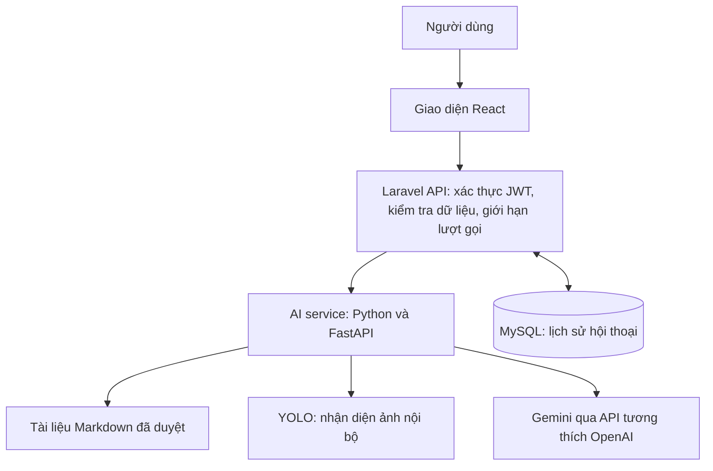
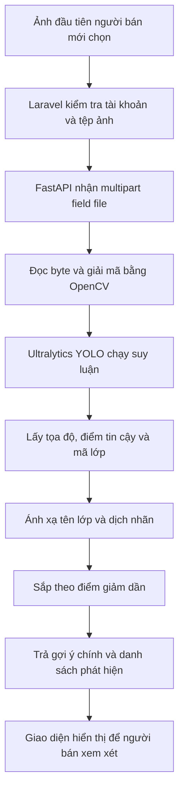
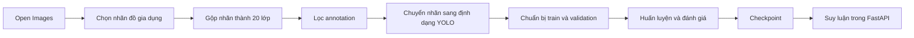

# Mô tả các chức năng AI trong dự án H-Smart

Tài liệu được đối chiếu với mã nguồn dự án ngày 04/11/2026. Phần YOLO tham khảo mã nguồn và các tệp model tại `D:\H-smart\ai-service`, cùng tài liệu huấn luyện và kết quả validation tại `D:\H-smart\docs`. Phạm vi mô tả gồm chức năng người dùng, kiến trúc xử lý, dữ liệu trao đổi, API và cấu hình triển khai. Các ví dụ phản hồi mang tính minh họa; số liệu đánh giá ở mục 4.13 được trích từ báo cáo và tệp kết quả có sẵn, không phải kết quả chạy đánh giá lại trong lần biên soạn này.

## 1. Tổng quan

H-Smart là hệ thống mua bán đồ cũ dành cho sinh viên. Dự án tích hợp AI để hỗ trợ người dùng tìm hiểu cách sử dụng hệ thống và giúp người bán chuẩn bị nội dung tin đăng.

### Cách đọc dành cho người không chuyên kỹ thuật

Có thể hình dung hệ thống có hai người phụ giúp: **YOLO xem ảnh để gợi ý đây là đồ vật gì**, còn **Gemini đọc thông tin để viết câu trả lời hoặc mô tả**. Người dùng vẫn là người kiểm tra và quyết định sử dụng kết quả.

Để hiểu chức năng, nên đọc mục 1, mục 3.1, mục 4.1–4.4 và mục 5.1 trước. Mục 4.12–4.13 giải thích dữ liệu và chất lượng nhận diện. Các bảng API, đoạn mã và lệnh ở mục 6–7 dành cho người cần tìm hiểu cách kết nối hoặc vận hành, có thể đọc sau. Mục 10 giải nghĩa các thuật ngữ trong tài liệu.

Một số từ dùng nhiều: **AI** là trí tuệ nhân tạo; **model/mô hình** là bộ máy được huấn luyện để thực hiện một nhiệm vụ; **service/dịch vụ** là phần mềm phụ trách một nhóm công việc; **API** là cách các phần mềm gửi yêu cầu và nhận kết quả từ nhau. **Khóa API** giống thẻ cho phép ứng dụng sử dụng dịch vụ của nhà cung cấp, cần được giữ bí mật.

| Chức năng | Công nghệ | Mục đích | Cần khóa API model ngôn ngữ |
| --- | --- | --- | --- |
| Trợ lý hỏi đáp H-Smart | Truy xuất tài liệu theo từ khóa kết hợp Gemini | Giải đáp hướng dẫn và chính sách có trong tài liệu đã duyệt | Có để tổng hợp câu trả lời; không cần khi chỉ trả trích đoạn |
| Nhận diện ảnh sản phẩm | Ultralytics YOLO chạy tại AI service | Nhận diện loại đồ vật, đưa ra tên gợi ý và điểm tin cậy | Không |
| Tạo mô tả sản phẩm | Gemini, tùy chọn bổ sung kết quả YOLO | Viết bản nháp mô tả tiếng Việt từ thông tin người bán cung cấp | Có |

Model ngôn ngữ mặc định trong cấu hình mẫu là `gemini-2.5-flash`, gọi qua API tương thích OpenAI. Đây là cấu hình mặc định của dự án; model thực tế phụ thuộc biến môi trường khi triển khai.

AI hỗ trợ soạn nội dung và hướng dẫn. Việc lưu hoặc gửi duyệt sản phẩm vẫn do người bán thực hiện bằng chức năng đăng bán thông thường.

## 2. Kiến trúc tích hợp

Hiểu theo cách gần gũi: giao diện là quầy tiếp nhận, backend là bộ phận kiểm tra và điều phối, AI service là bộ phận chuyên xử lý ảnh và văn bản, còn cơ sở dữ liệu là nơi lưu sổ sách. Khi người dùng bấm **Phân tích ảnh**, yêu cầu đi qua các bộ phận này rồi kết quả được trả về màn hình.



**Frontend React** cung cấp trang trợ lý tại `/assistant` và các nút hỗ trợ AI trong biểu mẫu đăng bán/chỉnh sửa sản phẩm. Frontend gọi Laravel với Bearer token, không giữ khóa Gemini.

**Backend Laravel** kiểm tra người dùng, quyền sở hữu hội thoại, dữ liệu đầu vào và tần suất gọi. Lớp `AiServiceClient` gửi yêu cầu tới AI service, kiểm tra cấu trúc phản hồi rồi trả kết quả cho frontend. Backend lưu lịch sử chatbot vào MySQL.

**AI service FastAPI** tải checkpoint YOLO khi khởi động, truy xuất kho tài liệu và gọi model ngôn ngữ. Trong Docker Compose, backend truy cập dịch vụ tại `http://ai:8000`; service AI không được ánh xạ cổng ra máy chủ trong cấu hình gốc.

**Gemini** tạo văn bản từ dữ kiện được gửi trong từng yêu cầu. Ảnh sản phẩm được YOLO xử lý nội bộ; luồng hiện tại không gửi ảnh gốc tới Gemini.

## 3. Trợ lý hỏi đáp H-Smart

### 3.1. Mục đích và cách sử dụng

Trợ lý giúp người dùng hỏi về tài khoản, tìm sản phẩm, đăng bán, đề nghị giá, đặt hàng, tin nhắn, báo cáo nội dung và các hướng dẫn khác có trong kho tri thức.

1. Đăng nhập và mở trang **Trợ lý H-Smart** tại `/assistant`.
2. Nhập câu hỏi hoặc chọn câu hỏi gợi ý.
3. Gửi câu hỏi và xem câu trả lời.
4. Mở lại hội thoại từ lịch sử, tạo cuộc trò chuyện mới hoặc xóa hội thoại của mình.

Ví dụ câu hỏi: “Làm thế nào để đăng bán sản phẩm?” hoặc “Tôi liên hệ quản trị viên ở đâu?”.

Backend nhận câu hỏi dài từ 2 đến 1.200 ký tự, giới hạn 10 yêu cầu/phút/tài khoản. Danh sách lịch sử trả tối đa 50 hội thoại, sắp theo thời điểm cập nhật gần nhất.

### 3.2. Cách xử lý câu hỏi

Chức năng sử dụng cách tiếp cận RAG: truy xuất nội dung liên quan trước, sau đó dùng model ngôn ngữ diễn đạt câu trả lời dựa trên nội dung đó. Phần truy xuất hiện tại là thuật toán từ khóa kiểu BM25 viết trực tiếp trong Python; chưa sử dụng embedding hoặc cơ sở dữ liệu vector.

Có thể hiểu **RAG** là “tìm trong sổ hướng dẫn rồi mới trả lời”. Khi hỏi cách đăng bán, hệ thống tìm đoạn hướng dẫn đăng bán trước rồi đưa cho Gemini diễn đạt lại. **BM25** là cách chấm xem đoạn nào chứa từ khóa phù hợp hơn; từ đặc trưng của câu hỏi có thể giúp một đoạn được ưu tiên. **Embedding** là cách biểu diễn nội dung thành dãy số để tìm theo mức gần nhau về ý nghĩa; dự án hiện chưa dùng cách này. Vì chủ yếu tìm theo từ, trợ lý có thể chưa tìm được đúng tài liệu khi người dùng diễn đạt bằng từ khác.

1. Khi module được nạp, AI service đọc các tệp `.md` trực tiếp trong `docs/assistant/approved`, được mount vào `/knowledge`.
2. Nội dung được chia theo heading cấp 2 (`##`); phần văn bản trước heading cấp 2 đầu tiên, nếu có, cũng được giữ thành một đoạn.
3. Câu hỏi và các đoạn được tách từ, chuyển về chữ thường; token dài không quá một ký tự được bỏ qua.
4. Service chấm điểm theo tần suất từ, mức độ phổ biến của từ trong kho và độ dài đoạn; lấy tối đa 4 đoạn có điểm cao nhất.
5. Nếu không có kết quả hoặc điểm cao nhất nhỏ hơn `1.25`, hệ thống trả thông báo chưa tìm thấy thông tin và không gọi Gemini.
6. Nếu có kết quả phù hợp và đủ cấu hình model, service gửi câu hỏi hiện tại cùng các đoạn tìm được cho Gemini.
7. Nếu thiếu cấu hình model, service trả tối đa 2 trích đoạn, mỗi đoạn tối đa 650 ký tự.
8. Laravel lưu câu hỏi, câu trả lời và thông tin nguồn của các đoạn đã truy xuất rồi trả kết quả cho giao diện.

Prompt yêu cầu Gemini trả lời tiếng Việt, ngắn gọn, chỉ dựa trên ngữ cảnh; không suy đoán thông tin cá nhân, trạng thái đơn hàng hoặc thanh toán. Các yêu cầu này định hướng model, không bảo đảm tuyệt đối mọi câu trả lời đều chính xác.

**Prompt** là lời hướng dẫn gửi cho AI, chẳng hạn “chỉ dùng thông tin trong tài liệu này”. **Ngữ cảnh/context** là thông tin AI được cung cấp để trả lời. **Kho tri thức** ở đây là các tài liệu hướng dẫn đã được duyệt, giống một cuốn sổ tay của H-Smart.

### 3.3. Lịch sử và nguồn tham chiếu

- `assistant_conversations` lưu hội thoại gắn với tài khoản.
- `assistant_messages` lưu vai trò, nội dung tin nhắn và nguồn tham chiếu của câu trả lời.
- Người dùng chỉ được xem hoặc xóa hội thoại thuộc tài khoản của mình.
- API có trả `citations` gồm `source_id`, `title`, `section`; giao diện hiện tại chỉ hiển thị nội dung tin nhắn, chưa hiển thị danh sách nguồn riêng.
- Lịch sử được lưu để người dùng xem lại. Mỗi lần gọi model chỉ gửi câu hỏi hiện tại và tài liệu truy xuất, chưa gửi các lượt trò chuyện trước. Vì vậy câu hỏi nối tiếp cần nêu rõ chủ đề.

Trợ lý không truy vấn dữ liệu giao dịch để trả lời câu hỏi cá nhân và không thực hiện thao tác thay đổi đơn hàng, thanh toán hoặc tài khoản.

### 3.4. Khi không trả lời được

Cần phân biệt ba tình huống:

| Tình huống | Hành vi |
| --- | --- |
| Không tìm thấy tài liệu đủ phù hợp | Trả thông báo chưa tìm thấy thông tin trong tài liệu đã duyệt |
| Thiếu cấu hình model nhưng có tài liệu phù hợp | Trả trích đoạn tài liệu |
| Đã cấu hình model nhưng lời gọi model lỗi | Trả lỗi dịch vụ; hiện không tự chuyển sang trích đoạn |

Khi lời gọi AI thất bại, controller xóa câu hỏi vừa lưu; nếu đó là hội thoại mới thì xóa cả hội thoại mới tạo.

## 4. Nhận diện ảnh sản phẩm bằng YOLO

### 4.1. Mục đích và cách sử dụng

Chức năng nhận diện loại đồ vật trong ảnh để hỗ trợ người bán điền tên sản phẩm.

1. Mở biểu mẫu đăng bán hoặc chỉnh sửa sản phẩm và chọn ảnh từ thiết bị.
2. Nhấn **Phân tích ảnh**.
3. Hệ thống phân tích ảnh đầu tiên trong danh sách ảnh mới chọn.
4. Giao diện hiển thị tên tiếng Việt và điểm tin cậy. Nếu có nhiều vật thể, giao diện còn hiển thị tối đa 5 kết quả trong danh sách chi tiết.
5. Nhấn **Dùng tên này** để điền nhãn nhận diện vào ô tên sản phẩm. Người bán có thể sửa tên sau đó.

Việc phân tích ảnh không tự thay tên. Nút **Dùng tên này** sẽ thay nội dung ô tên hiện tại. Khi sửa tin, ảnh đã lưu trên máy chủ không tự được gửi phân tích; luồng giao diện dùng `images[0]`, tức ảnh mới chọn đầu tiên.

### 4.2. Model và phạm vi nhận diện

**Huấn luyện/train** là cho model học từ nhiều ảnh có đáp án mẫu; **suy luận/inference** là dùng model đã học để nhận diện một ảnh mới. **Checkpoint** là tệp lưu kết quả đã học, giống lưu lại kiến thức sau quá trình luyện tập. H-Smart tải checkpoint có sẵn khi chạy, không huấn luyện lại mỗi lần người bán chọn ảnh.

Checkpoint được đóng gói tại `ai-service/models/household_yolo26n_best.pt`. Theo README AI service và tài liệu huấn luyện H-Smart, đây là model đồ gia dụng 20 lớp từ Open Images, huấn luyện bằng Ultralytics YOLO. Quy trình chuẩn bị dữ liệu và kết quả validation được trình bày ở mục 4.12–4.13, có nguồn từ tài liệu và tệp kết quả tham khảo.

Các nhãn và bản dịch được khai báo trong mã nguồn gồm:

**Lớp/class** là một nhóm đồ vật, ví dụ nhóm ghế; **nhãn/label** là tên nhóm được gán cho kết quả, ví dụ `chair`. Hai chiếc ghế trong cùng ảnh là hai vật thể nhưng cùng một lớp. **Bounding box/hộp bao** là khung chữ nhật khoanh vị trí một vật thể trong ảnh.

| Nhãn | Tên tiếng Việt | Nhãn | Tên tiếng Việt |
| --- | --- | --- | --- |
| `bed` | Giường | `lamp` | Đèn |
| `cabinet` | Tủ | `microwave` | Lò vi sóng |
| `chair` | Ghế | `mirror` | Gương |
| `table` | Bàn | `oven_stove` | Lò nướng/Bếp |
| `desk` | Bàn làm việc | `refrigerator` | Tủ lạnh |
| `sofa` | Sofa | `sink` | Bồn rửa |
| `blender` | Máy xay sinh tố | `faucet` | Vòi nước |
| `dishwasher` | Máy rửa chén | `television` | Tivi |
| `fan` | Quạt | `toaster` | Máy nướng bánh mì |
| `kettle` | Ấm đun nước | `washing_machine` | Máy giặt |

Khi tải model, service ưu tiên tên lớp trong checkpoint; danh sách khai báo là phương án dự phòng.

### 4.3. Luồng xử lý và kết quả

Laravel nhận ảnh JPEG, PNG hoặc WebP, dung lượng tối đa 10 MB, rồi chuyển sang FastAPI. OpenCV giải mã ảnh; YOLO dự đoán trên CPU theo mặc định, với ngưỡng điểm tin cậy `0.4`.

Mỗi vật thể trả về có:

| Trường | Ý nghĩa |
| --- | --- |
| `label` | Nhãn gốc của vật thể |
| `translated_label` | Tên tiếng Việt nếu có bản dịch |
| `class_id` | Mã lớp |
| `score` | Điểm tin cậy của model |
| `bbox` | Tọa độ hộp bao theo dạng `[x1, y1, x2, y2]` |

Service sắp kết quả theo điểm giảm dần, chọn vật thể có điểm cao nhất làm gợi ý chính và trả thêm `confidence`, `num_detections`, `detections`. Nếu không nhận diện được, kết quả chính là `unknown` / **Không xác định**, điểm bằng 0 và danh sách rỗng.

Điểm tin cậy không phải độ chính xác đã được kiểm chứng. Model nhận diện loại đồ vật, không xác minh thương hiệu, mức độ hư hỏng, chất lượng hay giá trị sản phẩm. Hiệu quả có thể giảm khi ảnh tối, vật thể bị che hoặc sản phẩm nằm ngoài các lớp hỗ trợ.

Endpoint Laravel giới hạn 10 yêu cầu/phút/tài khoản. Giới hạn ảnh 10 MB được kiểm tra tại Laravel; endpoint nhận diện nội bộ FastAPI hiện không có cùng kiểm tra dung lượng tối đa.

### 4.4. Vai trò của YOLO trong nghiệp vụ đăng bán

Trong H-Smart, YOLO thực hiện bài toán **phát hiện vật thể trong ảnh**: trả về loại vật thể và vị trí của từng vật thể được phát hiện. Một ảnh có thể chứa nhiều kết quả, chẳng hạn ghế, bàn và đèn. Điều này cho phép hệ thống vừa đưa ra một tên gợi ý chính, vừa giữ lại danh sách các vật thể còn lại.

Kết quả nhận diện được sử dụng ở hai bước nghiệp vụ:

- **Gợi ý tên sản phẩm:** lấy nhãn tiếng Việt của kết quả có điểm cao nhất để người bán lựa chọn. Khi người bán nhấn **Dùng tên này**, frontend điền nhãn vào ô tên.
- **Bổ sung dữ kiện cho bản nháp mô tả:** chuyển các nhãn YOLO cùng điểm tin cậy sang dạng văn bản để model ngôn ngữ tham khảo cùng thông tin người bán nhập.

Luồng hiện tại chưa tự chọn danh mục từ nhãn, chưa tự định giá và chưa dùng nhận diện để quyết định duyệt tin. Nhãn “Ghế” chỉ cho biết model phát hiện một vật thể thuộc lớp ghế; nó không chứng minh chiếc ghế còn tốt, thuộc thương hiệu nào hoặc có giá bao nhiêu.

Một giới hạn nghiệp vụ là service chọn gợi ý chính theo **điểm tin cậy cao nhất**, không theo diện tích hộp bao hoặc vị trí trung tâm ảnh. Nếu người bán chụp bàn cạnh một chiếc ghế, model có thể chọn “Ghế” dù món cần bán là bàn. Vì vậy người bán cần kiểm tra trước khi áp dụng tên gợi ý.

### 4.5. Tổ chức mã nguồn và vòng đời model

Phần nhận diện được chia thành các lớp có trách nhiệm riêng:

| Thành phần | Trách nhiệm trong luồng YOLO |
| --- | --- |
| `Settings` | Đọc đường dẫn checkpoint, ngưỡng điểm, thiết bị và chế độ demo từ môi trường |
| `YoloDetector` | Nạp checkpoint, giải mã ảnh, chạy model và chuyển kết quả thành các đối tượng `Detection` |
| `ObjectDetector` | Khai báo giao diện `predict(image_bytes)` mà detector cần cung cấp |
| `PredictImageUseCase` | Nhận dữ liệu ảnh và gọi detector được truyền vào |
| `get_predict_image_use_case` | Lấy use case từ trạng thái ứng dụng, báo lỗi nếu chưa khởi tạo |
| Route `/api/v1/predict` | Nhận tệp upload, xử lý lỗi và tạo phản hồi API |
| `Detection` / `DetectionResponse` | Chuẩn hóa cấu trúc kết quả bên trong ứng dụng và khi trả JSON |

Khi FastAPI khởi động, hàm `lifespan` tạo detector và use case rồi lưu vào `app.state`. Các yêu cầu nhận diện trong cùng một tiến trình sử dụng lại detector này, thay vì tải lại checkpoint cho mỗi ảnh. Nếu chạy nhiều worker, mỗi tiến trình khởi tạo detector riêng; tăng worker vì vậy có thể làm tăng bộ nhớ dùng cho model.

Nếu không bật demo và checkpoint không tồn tại, constructor phát sinh `FileNotFoundError`, làm quá trình khởi tạo ứng dụng thất bại. Nếu detector hoặc use case chưa được gắn vào trạng thái ứng dụng, dependency trả HTTP `503` với thông báo `Model is not initialized`.

### 4.6. Quy trình xử lý ảnh chi tiết



**Bước 1 — tiếp nhận tệp.** Route FastAPI kiểm tra `content_type` bắt đầu bằng `image/`, đọc nội dung tệp và từ chối tệp rỗng. Ở luồng người dùng thông thường, Laravel đã kiểm tra định dạng và dung lượng trước khi chuyển tiếp.

**Bước 2 — giải mã.** `numpy.frombuffer(image_bytes, np.uint8)` tạo mảng byte; `cv2.imdecode(..., cv2.IMREAD_COLOR)` chuyển dữ liệu nén thành ảnh màu OpenCV. Nếu không giải mã được, detector phát sinh `ValueError`. Mã ứng dụng không tự chuyển BGR sang RGB trước khi gọi Ultralytics.

**Bước 3 — suy luận.** Detector gọi:

```python
results = self.model.predict(
    source=image,
    conf=self.score_threshold,
    device=self.device,
    verbose=False,
)
```

Ứng dụng chỉ truyền ảnh, ngưỡng điểm, thiết bị và tùy chọn tắt log suy luận. Các bước tiền xử lý bên trong model do thư viện Ultralytics thực hiện. Mã gọi hiện không đặt tường minh `imgsz`, `iou` hoặc `max_det`; không thể lấy các giá trị trong tệp YAML khác để khẳng định đây là cấu hình suy luận đang dùng.

**Bước 4 — đọc đầu ra.** Vì mỗi yêu cầu xử lý một ảnh, detector đọc `results[0].boxes`. Từ đó lấy `boxes.xyxy`, `boxes.conf` và `boxes.cls`, chuyển các tensor về CPU rồi thành danh sách Python. Nếu không có kết quả hoặc không có hộp bao, detector trả danh sách rỗng.

**Bước 5 — chuẩn hóa.** Mã lớp được chuyển thành số nguyên và kiểm tra phạm vi hợp lệ. Tên lớp được lấy từ metadata model; nhãn tiếng Việt được tra từ `LABEL_TRANSLATIONS`. Nếu chưa có bản dịch, service giữ nguyên tên lớp. Điểm tin cậy được làm tròn 4 chữ số thập phân, tọa độ được làm tròn 2 chữ số thập phân.

**Bước 6 — tạo phản hồi.** Danh sách phát hiện được sắp theo điểm giảm dần. Route chọn kết quả tốt nhất làm `label`, `translated_label`, `confidence`, đồng thời trả toàn bộ danh sách và số lượng phát hiện.

### 4.7. Cách đọc điểm tin cậy và hộp bao

Với ngưỡng mặc định `0.4`, ứng dụng yêu cầu Ultralytics lọc kết quả theo ngưỡng điểm này. Tăng ngưỡng có thể giảm các phát hiện ít chắc chắn nhưng cũng có thể bỏ sót vật thể; giảm ngưỡng có thể giữ thêm kết quả nhưng cần đánh giá khả năng nhận diện nhầm. Đây là sự đánh đổi cần đo trên bộ ảnh thực tế của H-Smart.

`score=0.91` được giao diện hiển thị thành `91%`. Giá trị này là điểm do model tạo ra cho một phát hiện cụ thể, không có nghĩa hệ thống đã được đo đạt độ chính xác 91% trên mọi sản phẩm. `confidence` ở cấp phản hồi là điểm của vật thể được chọn làm gợi ý chính, không phải điểm trung bình của toàn ảnh.

`bbox=[x1, y1, x2, y2]` mô tả góc trên trái và góc dưới phải của hộp bao theo tọa độ pixel ảnh. Ví dụ `[120, 80, 420, 560]` có chiều rộng `300` pixel và chiều cao `480` pixel. Nếu sau này vẽ hộp lên ảnh hiển thị đã đổi kích thước, frontend cần nhân tọa độ với tỷ lệ hiển thị tương ứng. Giao diện hiện tại hiển thị nhãn và điểm, chưa vẽ hộp bao.

Ví dụ phản hồi minh họa cho một ảnh có ghế:

```json
{
  "label": "chair",
  "confidence": 0.91,
  "translated_label": "Ghế",
  "num_detections": 1,
  "detections": [
    {
      "label": "chair",
      "class_id": 2,
      "score": 0.91,
      "bbox": [120.0, 80.0, 420.0, 560.0],
      "translated_label": "Ghế"
    }
  ]
}
```

Trong ví dụ, `class_id=2` theo danh sách lớp dự phòng của mã nguồn. Khi thay checkpoint, phải đối chiếu lại metadata lớp thực tế; không nên mặc định mã số lớp luôn giữ nguyên.

`num_detections` đếm số vật thể được trả về, không đếm số loại khác nhau. Hai chiếc ghế có thể tạo hai phần tử cùng nhãn `chair` và hai hộp bao khác nhau. Khi không phát hiện vật thể, service vẫn trả phản hồi thành công với nhãn `unknown`, điểm `0.0` và danh sách rỗng; đây không phải lỗi kết nối AI.

### 4.8. Checkpoint đang dùng và các tệp model tham khảo

Khi khảo sát `D:\H-smart\ai-service`, thư mục `models` chứa nhiều tệp. Cần phân biệt sự có mặt của tệp với việc tệp đó được dùng khi chạy:

| Tệp | Kết quả đối chiếu mã nguồn |
| --- | --- |
| `household_yolo26n_best.pt` | Checkpoint mặc định được `Settings` trỏ tới và `YoloDetector` nạp bằng `YOLO(...)`; Dockerfile cũng sao chép tệp này vào image |
| `config_infer.yaml` | Có cấu hình `GeneralizedRCNN`, backbone ResNet-FPN, ROI heads 53 lớp và đường dẫn trọng số `.pth`; không được luồng YOLO hiện tại đọc |
| `model.pth`, `model (1).pth` | Có trong thư mục tham khảo nhưng không được mã khởi tạo detector hiện tại nạp |
| `classes.json` | Không được `YoloDetector` đọc; tên lớp hiện được lấy từ checkpoint hoặc `CLASS_NAMES` |
| `refind_bundle.zip` | Có trong thư mục tham khảo nhưng không được luồng nhận diện hiện tại giải nén hoặc nạp |

Vì vậy không dùng số lớp 53, kích thước ảnh, số vòng lặp hay tham số huấn luyện trong `config_infer.yaml` để mô tả checkpoint YOLO đang hoạt động. Những thông tin này thuộc một cấu hình khác với luồng suy luận đã đối chiếu.

Tệp `requirements.txt` tham khảo ghim `ultralytics==8.4.70`, `torch==2.1.2+cpu`, `torchvision==0.16.2+cpu` và `numpy<2`, đồng thời sử dụng OpenCV headless. Đây là các phiên bản khai báo trong mã nguồn, chưa phải kết quả kiểm tra package thực tế của một container đang chạy. Với bộ phụ thuộc CPU này, chỉ đổi `AI_DEVICE` chưa đủ để chuyển sang chạy GPU; môi trường còn cần bộ PyTorch và phần cứng phù hợp.

Tên checkpoint chứa `yolo26n` và `best`, nhưng chỉ tên tệp không đủ để kết luận cấu trúc mạng chi tiết, số epoch hoặc tiêu chí chọn model tốt nhất. Tài liệu trong `D:\H-smart\docs` có mô tả dữ liệu và báo cáo validation cho checkpoint này, được bổ sung ở mục 4.12–4.14. Các nguồn đã đọc chưa cung cấp đầy đủ lệnh huấn luyện, số epoch và lịch sử loss để tái hiện toàn bộ quá trình train.

### 4.9. Kết hợp YOLO với chức năng tạo mô tả

YOLO và Gemini đảm nhiệm hai việc khác nhau trong yêu cầu tạo mô tả. YOLO chuyển ảnh thành dữ kiện về loại vật thể; Gemini dùng các dữ kiện văn bản để viết câu mô tả. Ảnh gốc không được chuyển tiếp tới Gemini trong luồng này.

Nếu ảnh có nhiều phát hiện, hàm `_detection_context` gộp các kết quả có cùng nhãn tiếng Việt, giữ điểm cao nhất của mỗi nhãn rồi lấy tối đa 8 nhãn. Ví dụ hai chiếc ghế và một chiếc bàn có thể được chuyển thành chuỗi dạng `Ghế (91%), Bàn (85%)`. Chuỗi này không còn chứa hộp bao hay số lượng từng loại, nên không nên xem nó là dữ kiện để Gemini khẳng định số lượng sản phẩm.

Nếu không có phát hiện, prompt bổ sung thông báo YOLO chưa nhận diện được vật thể rõ ràng và yêu cầu model không tự đoán loại sản phẩm từ ảnh. Gemini vẫn có thể tạo mô tả dựa trên tên, danh mục, tình trạng và ghi chú đã nhập. Nếu việc giải mã hoặc suy luận ảnh phát sinh lỗi, yêu cầu tạo mô tả có ảnh hiện trả lỗi; chưa tự bỏ qua ảnh để tiếp tục tạo mô tả chỉ từ văn bản.

Mỗi lần bấm tạo mô tả có đính kèm ảnh sẽ gọi YOLO trong yêu cầu đó. Frontend hiện không gửi lại kết quả của lần **Phân tích ảnh** trước để tái sử dụng, vì vậy hai thao tác liên tiếp có thể chạy nhận diện hai lần.

### 4.10. Lỗi thường gặp và cách kiểm tra

| Tình huống | Hành vi hoặc cách kiểm tra |
| --- | --- |
| Thiếu checkpoint | Service không hoàn tất khởi tạo; kiểm tra `AI_MODEL_PATH` và tệp `.pt` |
| Tệp rỗng hoặc sai định dạng ảnh | Route nhận diện trả HTTP `400`; kiểm tra ảnh có mở được và được gửi đúng field `file` |
| Nội dung không giải mã được | OpenCV trả ảnh rỗng, detector phát sinh `ValueError`, route trả HTTP `400` |
| Chưa khởi tạo use case | Dependency trả HTTP `503` |
| Lỗi suy luận ngoài dự kiến | Route nhận diện nội bộ trả HTTP `500`; Laravel chuyển lỗi service thành `503 / AI_UNAVAILABLE` |
| Không phát hiện được vật thể | Nhận `unknown` với danh sách rỗng; thử ảnh rõ hơn hoặc kiểm tra sản phẩm có thuộc lớp hỗ trợ |
| Kết quả giả lập nhưng tưởng là nhận diện thật | Kiểm tra `demo_mode`; demo trả điểm cố định `0.91` và hộp bao rỗng |

Để thử trực tiếp API nội bộ sau khi đã khởi động service cục bộ tại cổng 8000:

```powershell
Invoke-RestMethod -Uri http://localhost:8000/health
curl.exe -X POST http://localhost:8000/api/v1/predict -F "file=@D:/duong-dan/anh-san-pham.jpg"
```

Thay đường dẫn ảnh bằng tệp thực tế. Ví dụ dùng `curl.exe` để gọi chương trình curl trên Windows. Cổng này áp dụng khi chạy service trực tiếp; với Compose của dự án PHP, service AI mặc định chỉ truy cập qua mạng nội bộ Docker như mục 2 đã mô tả.

`/health` trả `model_loaded=true` khi đối tượng detector đã được tạo. Trường này cũng có thể đúng khi dùng `DemoDetector`, vì vậy cần kiểm tra đồng thời `demo_mode=false` để phân biệt chế độ thật. Health check không thay thế việc thử suy luận bằng ảnh mẫu.

### 4.11. Giới hạn và hướng đánh giá chất lượng

Các giới hạn hiện tại cần được tính đến khi sử dụng:

- Phạm vi lớp tập trung vào đồ gia dụng và nội thất; không bao phủ mọi loại hàng của một sàn đồ cũ.
- Ảnh chụp nhiều món có thể làm gợi ý chính lệch khỏi món người bán muốn đăng.
- Nhãn chỉ mô tả loại đồ vật, không xác nhận tình trạng, hàng chính hãng, phụ kiện hoặc lỗi kỹ thuật.
- Endpoint nhận diện chưa lưu kết quả để tái sử dụng hoặc ghi nhận phản hồi đúng/sai của người bán.
- Chưa có giới hạn kích thước ảnh theo số pixel trong route nhận diện; giới hạn dung lượng upload ở Laravel không đồng nghĩa giới hạn bộ nhớ ảnh sau giải mã.
- Luồng hiện gọi suy luận đồng bộ từ route `async`, chưa tách công việc YOLO sang hàng đợi hoặc worker suy luận riêng. Cần đo khả năng đáp ứng trước khi tăng lượng truy cập đồng thời.

Để đánh giá trước khi mở rộng triển khai, nên chuẩn bị bộ ảnh đồ cũ thực tế, có nhãn loại vật thể và hộp bao chuẩn. Bộ ảnh cần bao gồm từng lớp hỗ trợ, ảnh nhiều vật thể, ảnh thiếu sáng và ảnh sản phẩm ngoài phạm vi. Các chỉ số cần ghi nhận gồm precision, recall, mAP theo lớp, tỷ lệ gợi ý chính đúng với món cần bán, tỷ lệ không nhận diện được, thời gian phản hồi và mức sử dụng bộ nhớ.

Đây là hướng kiểm thử bổ sung cho môi trường sử dụng thực tế. Kết quả validation có sẵn trong tài liệu nguồn được trình bày ở mục 4.13; chúng chưa thay thế đánh giá trên ảnh đồ cũ của người dùng H-Smart tại Việt Nam hoặc benchmark tải của dự án PHP.

### 4.12. Cơ sở YOLO và quy trình xây dựng bộ dữ liệu

Phần này tham khảo thêm các tài liệu trong `D:\H-smart\docs`, được tìm thấy khi đối chiếu thư mục AI service người dùng cung cấp. Các số liệu được trích từ tài liệu và tệp kết quả có sẵn, không phải kết quả chạy huấn luyện hoặc đánh giá lại trong lần biên soạn này.

Theo `noi-dung-ai-service-word-ready.md`, YOLO (You Only Look Once) là mô hình phát hiện đối tượng một giai đoạn, xử lý ảnh qua mạng để dự đoán lớp và hộp bao của các vật thể. Cách tiếp cận này phù hợp với vai trò nhận ảnh và trả gợi ý trực tiếp cho biểu mẫu đăng bán. Độ trễ cụ thể vẫn cần đo trên phần cứng triển khai.

**Nguồn và quy mô dữ liệu.** Bộ dữ liệu được chọn lọc từ Open Images, chuẩn hóa thành 20 lớp đồ gia dụng. Tệp kết quả đánh giá ghi đường dẫn dataset là `D:\AI_Datasource\open_images_v7_household\dataset.yaml`.

| Tập dữ liệu | Số ảnh | Số bounding box theo báo cáo |
| --- | --- | --- |
| Train | 19.517 | 58.700 |
| Validation trước xử lý nhãn trùng khi đánh giá | 1.183 | 3.804 |
| Validation thực tế được tính trong lượt đánh giá | 1.183 | 3.786 đối tượng hợp lệ |

Theo báo cáo, Ultralytics loại một số nhãn trùng khi đánh giá, nên số đối tượng hợp lệ ít hơn 18 so với số bounding box ban đầu. Hai con số mô tả số nhãn trước và sau bước xử lý của lượt đánh giá, không phải hai tập validation độc lập.

**Gộp nhãn theo nghiệp vụ.** Các nhãn có ý nghĩa gần nhau trong Open Images được quy về cùng lớp:

| Nhãn nguồn được nêu trong tài liệu | Lớp đầu ra |
| --- | --- |
| `Bench`, `Chair`, `Stool` | `chair` — Ghế |
| `Bathroom cabinet`, `Bookcase`, `Cupboard`, `Shelf`, `Wardrobe` | `cabinet` — Tủ |

Việc gộp làm đầu ra phù hợp hơn với nhóm sản phẩm của H-Smart, đồng thời giảm độ chi tiết. Chẳng hạn nhãn `cabinet` không xác định riêng tủ quần áo hay giá sách; người bán cần bổ sung tên cụ thể.

**Chuẩn hóa annotation.** Tài liệu mô tả việc loại annotation có thuộc tính `IsGroupOf` và `IsDepiction`, rồi chuyển hộp bao sang định dạng YOLO:

**Annotation** là đáp án do người gán nhãn chuẩn bị, chẳng hạn vẽ khung quanh chiếc ghế và ghi “ghế”, để model có mẫu học và mẫu đối chiếu. `IsGroupOf` đánh dấu nhóm nhiều vật thể thay vì một vật thể riêng; `IsDepiction` đánh dấu hình thể hiện của vật thể, chẳng hạn chiếc ghế trong tranh. Tài liệu nguồn mô tả loại các annotation này khi chuẩn bị dữ liệu.

```text
class_id x_center y_center width height

x_center = (x_min + x_max) / (2 × W)
y_center = (y_min + y_max) / (2 × H)
width    = (x_max - x_min) / W
height   = (y_max - y_min) / H
```

Trong đó `W`, `H` là chiều rộng và chiều cao ảnh. Nhãn huấn luyện dùng tọa độ chuẩn hóa theo kích thước ảnh; đầu ra API của H-Smart dùng hộp bao `xyxy` theo pixel. Đây là hai định dạng phục vụ hai bước khác nhau.

**Pixel** là một điểm nhỏ cấu tạo nên ảnh. **Chuẩn hóa tọa độ** là đổi từ số pixel sang tỷ lệ của kích thước ảnh: hộp rộng 200 pixel trên ảnh rộng 1.000 pixel có tỷ lệ `0,2`, tức 20%. Cách ghi theo tỷ lệ giúp biểu diễn vị trí trên các ảnh có kích thước khác nhau. Người đọc không cần tính các công thức để sử dụng chức năng.

Tài liệu cơ sở lý thuyết mô tả `dataset.yaml` khai báo đường dẫn train/validation, `nc=20` và tên lớp. Sau huấn luyện, checkpoint được đóng gói thành `household_yolo26n_best.pt` để service nạp khi khởi động.



**Mất cân bằng lớp.** Theo tài liệu nguồn, các lớp `chair`, `cabinet`, `table` có nhiều mẫu hơn `toaster`, `dishwasher`, `blender`. Chỉ số tổng hợp vì vậy không đủ để kết luận chất lượng đồng đều giữa các loại sản phẩm; cần đánh giá theo lớp và bổ sung ảnh cho các nhóm ít mẫu.

### 4.13. Kết quả đánh giá YOLO từ tài liệu tham khảo

**Train** là tập ảnh dùng để học; **validation/val** là tập ảnh dùng để kiểm tra trong quá trình phát triển model. Có thể hình dung train là bài luyện tập và validation là bài kiểm tra để biết model làm tốt đến đâu. **Tập test độc lập** là bộ ảnh dành riêng cho đánh giá cuối, không dùng để chọn hay chỉnh model. Điểm validation chưa bảo đảm kết quả tương đương trên mọi ảnh do người dùng chụp.

Các chỉ số sau đã được đối chiếu giữa `ket-qua-huan-luyen-yolo-word-ready.md` và `yolo-training-results/household_yolo_val/metrics-summary.json`. JSON ghi model là `D:\H-smart\ai-service\models\household_yolo26n_best.pt` và tập đánh giá là `val`.

| Chỉ số | Giá trị làm tròn | Ý nghĩa |
| --- | --- | --- |
| Precision | 0,5872 | Đánh giá mức hạn chế phát hiện sai theo cách tổng hợp của công cụ đánh giá |
| Recall | 0,5385 | Đánh giá khả năng tìm được các đối tượng đã gán nhãn |
| mAP@50 | 0,5761 | AP trung bình qua các lớp tại ngưỡng IoU 0,50 |
| mAP@50-95 | 0,4521 | AP trung bình qua các lớp và các ngưỡng IoU từ 0,50 đến 0,95 |

IoU là diện tích phần giao chia cho diện tích phần hợp của hộp bao dự đoán và hộp bao chuẩn. mAP vì vậy xét cả nhãn và khả năng định vị vật thể. Không diễn giải `mAP@50=0,5761` thành “57,61% ảnh được nhận diện đúng”, vì đây không phải accuracy theo ảnh.

**Ví dụ dễ hình dung về các chỉ số** — những con số dưới đây chỉ để giải thích, không phải kết quả của model H-Smart:

- **Precision — trong các lần AI nhận là ghế, bao nhiêu lần đúng?** Nếu AI khoanh 10 vật thể và gọi là ghế, trong đó có 8 chiếc ghế thật, precision của ví dụ là `8/10 = 80%`. Chỉ số này giúp xem AI có thường nhận nhầm vật khác thành ghế hay không.
- **Recall — trong các chiếc ghế cần tìm, AI tìm được bao nhiêu?** Nếu ảnh có 12 chiếc ghế được gán nhãn chuẩn và AI tìm đúng 8 chiếc, recall là `8/12 ≈ 66,7%`. Chỉ số này giúp xem AI có bỏ sót nhiều hay không. Cùng một kết quả có thể ít nhận nhầm nhưng vẫn bỏ sót.
- **IoU — khung AI vẽ có khớp với khung đáp án không?** Hãy tưởng tượng đặt hai khung chữ nhật lên cùng ảnh. Càng trùng nhau, IoU càng cao; trùng hoàn toàn là 1, không có phần giao là 0. Chỉ gọi đúng tên nhưng vẽ khung sai vị trí vẫn có thể bị tính là phát hiện sai.
- **AP — điểm tổng hợp cho một lớp đồ vật.** Thay vì xem ở một ngưỡng tin cậy duy nhất, AP tóm tắt quan hệ giữa precision và recall khi thay đổi ngưỡng. Nó giúp đánh giá một lớp, chẳng hạn lớp ghế, trên cả quá trình cân bằng nhận nhầm và bỏ sót.
- **mAP — lấy trung bình AP của các lớp.** Model có nhiều loại đồ vật nên cần một điểm tổng hợp. `@50` nghĩa là dùng mức khớp hộp bao IoU 0,50 để xét một phát hiện đủ khớp; `@50-95` tổng hợp ở các mức 0,50; 0,55; …; 0,95, gồm cả các mức đòi hỏi khung rất sát đáp án. Số 50 ở đây nói về độ khớp hộp, không phải ngưỡng tin cậy AI 50%.

**F1** là điểm kết hợp precision và recall, hữu ích khi muốn cân bằng cả nhận nhầm và bỏ sót. **Confusion matrix/ma trận nhầm lẫn** là bảng cho thấy AI thường nhầm loại nào thành loại nào, ví dụ ghế thành sofa. **Đường cong** là biểu đồ cho thấy chỉ số thay đổi ra sao khi đổi ngưỡng; không phải kết quả chỉ của một ảnh.

Các ví dụ precision/recall ở trên minh họa cách hiểu cơ bản cho một lớp. Chỉ số tổng hợp của bộ đánh giá có thể được tính trung bình qua nhiều lớp, nên không dùng chúng để suy ngược ra số lượng vật thể đúng/sai chính xác của toàn bộ dataset.

Kết quả cho thấy model đã học được các lớp đồ gia dụng trong bộ validation nhưng vẫn phát hiện sai và bỏ sót. mAP giảm từ `0,5761` xuống `0,4521` khi yêu cầu độ khớp hộp bao chặt chẽ hơn. Các số liệu hỗ trợ việc đánh giá model ở vai trò gợi ý để người bán xem lại; chưa đủ để kết luận có thể tự kiểm duyệt mọi tin đăng.

Không đồng nhất các chỉ số validation với `confidence` của một ảnh. Tệp tổng hợp không ghi ngưỡng confidence dùng để tổng hợp precision/recall, nên chưa thể khẳng định các chỉ số đó được đo tại ngưỡng API `0.4`.

**Minh chứng đi kèm.** Những tệp sau được tìm thấy trong `D:\H-smart\docs\yolo-training-results\household_yolo_val`:

| Tệp | Nội dung dùng để phân tích |
| --- | --- |
| `metrics-summary.json` | Chỉ số tổng hợp, đường dẫn model, dataset và split |
| `confusion_matrix.png` | Ma trận nhầm lẫn giữa các lớp |
| `confusion_matrix_normalized.png` | Ma trận nhầm lẫn chuẩn hóa |
| `BoxPR_curve.png` | Đường cong precision–recall |
| `BoxF1_curve.png` | F1 theo confidence |
| `BoxP_curve.png`, `BoxR_curve.png` | Precision và recall theo confidence |
| `val_batch0_labels.jpg` đến `val_batch2_labels.jpg` | Nhãn chuẩn của các batch validation minh họa |
| `val_batch0_pred.jpg` đến `val_batch2_pred.jpg` | Kết quả dự đoán tương ứng |

Tài liệu nguồn lưu ý chưa có `results.png` của quá trình train đầy đủ. Các hình trên là kết quả validation từ checkpoint, không phải lịch sử huấn luyện. Lần biên soạn này xác nhận tệp tồn tại và đọc số liệu JSON, chưa chạy lại validation hoặc phân tích từng đường cong để chọn ngưỡng tối ưu.

Tài liệu còn ghi nhận một ảnh ghế văn phòng được nhận diện với confidence `0,8849` và luồng product-service trả nhãn tiếng Việt cùng metadata. Đây là ví dụ kiểm thử tích hợp của phiên bản nguồn, không phải độ chính xác trên toàn bộ dữ liệu hoặc kết quả kiểm thử lại của dự án PHP.

### 4.14. Phạm vi kế thừa và nguồn tài liệu nội bộ

Tài liệu trong `D:\H-smart\docs` mô tả phiên bản dùng microservices Java, product-service, interaction-service, API Gateway, nghiệp vụ trên GCP và AI trên DigitalOcean. Tài liệu đó còn mô tả chọn ảnh bằng `analysisImageIndex`, lưu metadata kiểm duyệt và tạo sản phẩm ở trạng thái `PENDING_REVIEW` khi AI lỗi.

Tài liệu hiện tại kế thừa phần mô hình, dữ liệu và kết quả đánh giá có nguồn ghi nhận. Những hành vi của phiên bản Java là thông tin tham khảo; giao diện và API của dự án PHP vẫn được mô tả theo mã React/Laravel. Dự án PHP gửi ảnh mới chọn đầu tiên, trả lỗi riêng cho thao tác hỗ trợ AI khi service không khả dụng và cho phép người bán tiếp tục tự nhập nội dung.

Các nguồn đã sử dụng, với đường dẫn tính từ `D:\H-smart`:

| Nguồn | Nội dung tham khảo |
| --- | --- |
| `ai-service/README.md` và `ai-service/app/` | Checkpoint, luồng suy luận, API và cấu trúc kết quả |
| `docs/noi-dung-ai-service-word-ready.md` | Cơ sở YOLO, xử lý dữ liệu, gộp nhãn và giới hạn |
| `docs/cap-nhat-yolo-vao-ban-word.md` | Chuyển sang YOLO và kiểm thử tích hợp của phiên bản nguồn |
| `docs/ket-qua-huan-luyen-yolo-word-ready.md` | Quy mô dữ liệu, số đối tượng hợp lệ và chỉ số validation |
| `docs/chuong-2-co-so-ly-thuyet-word-ready.md` | Định dạng nhãn, khai báo dataset và quy trình chuẩn bị dữ liệu |
| `docs/yolo-training-results/household_yolo_val/metrics-summary.json` | Đối chiếu precision, recall, mAP và checkpoint được đánh giá |
| `docs/diagrams/ch2-06-ai-detection-pipeline.mmd` | Sơ đồ chuẩn bị dữ liệu và suy luận |

Các nguồn này nằm ngoài repository PHP. Số liệu và phần giải thích cần thiết đã được đưa trực tiếp vào tài liệu để người đọc vẫn theo dõi được khi chỉ có mã nguồn PHP.

## 5. Tạo bản nháp mô tả sản phẩm bằng Gemini

### 5.1. Mục đích và cách sử dụng

Chức năng giúp người bán chuyển thông tin đã nhập thành mô tả tiếng Việt ngắn gọn.

1. Nhập tên sản phẩm, chọn danh mục và tình trạng.
2. Có thể nhập thông tin bổ sung vào ô **Mô tả / thông tin thêm** và chọn ảnh.
3. Nhấn **Tạo mô tả bằng AI**.
4. Kết quả được điền trực tiếp vào ô mô tả, thay nội dung đang có.
5. Người bán đọc lại, sửa nội dung và tự gửi sản phẩm để duyệt hoặc lưu thay đổi.

Không cần bấm **Phân tích ảnh** trước. Nếu có ảnh mới chọn, service tự chạy YOLO trong yêu cầu tạo mô tả. Nếu không có ảnh, chức năng vẫn tạo mô tả từ dữ kiện văn bản khi dịch vụ hoạt động bình thường.

### 5.2. Dữ liệu đầu vào

| Trường tại Laravel | Ràng buộc | Cách sử dụng |
| --- | --- | --- |
| `title` | Bắt buộc, 3–200 ký tự | Tên người bán nhập |
| `category` | Bắt buộc, 1–120 ký tự | Tên danh mục dạng văn bản |
| `condition` | `new`, `like_new`, `good`, `fair`, `poor` | Được chuyển thành nhãn tình trạng trong prompt |
| `price` | Tùy chọn, số từ 0 đến 999999999999 | API nhận và chuyển tiếp nhưng không đưa vào prompt tạo mô tả |
| `seller_notes` | Tùy chọn, tối đa 2.500 ký tự | Frontend lấy từ nội dung ô mô tả hiện tại |
| `image` | Tùy chọn, JPEG/PNG/WebP, tối đa 10 MB | YOLO nhận diện nội bộ; Gemini chỉ nhận nhãn và điểm |

Ô mô tả thông thường cho phép tới 5.000 ký tự, nhưng khi dùng làm `seller_notes` cho AI chỉ được tối đa 2.500 ký tự. Nội dung dài hơn sẽ không qua bước kiểm tra API tạo mô tả.

### 5.3. Nguyên tắc tạo nội dung

Gemini nhận tên, danh mục, tình trạng, ghi chú và kết quả nhận diện nếu có. Các nhãn YOLO được gộp trùng theo điểm cao nhất, lấy tối đa 8 nhãn khác nhau để bổ sung ngữ cảnh.

Prompt yêu cầu model:

- Khi đủ dữ kiện, viết khoảng 5–8 câu trong 2 đoạn ngắn, hướng tới 100–180 từ và tối đa 2.200 ký tự. Dữ kiện ít thì viết ngắn hơn, ưu tiên chính xác thay vì kéo dài hoặc lặp ý.
- Chỉ dùng dữ kiện được cung cấp, bỏ qua chi tiết còn thiếu.
- Không suy đoán thương hiệu, model, kích thước, chất liệu, tuổi sản phẩm, lịch sử sử dụng, lỗi, phụ kiện, bảo hành hoặc nguồn gốc.
- Xem nhãn YOLO như gợi ý loại vật thể, không xem là bằng chứng về tình trạng.
- Giữ nguyên thông tin về lỗi, thiếu phụ kiện và hạn chế; không tự nâng tình trạng. Không biến đồ vật khác trong ảnh thành phụ kiện, không tự đổi loại sản phẩm theo YOLO khi khác thông tin người bán nhập.
- Không nhắc giá; không thêm tiêu đề, Markdown, hashtag hoặc lời quảng cáo cường điệu.

Service kiểm tra kết quả là chuỗi không rỗng, tối đa 2.500 ký tự. Các yêu cầu về số câu và tính trung thực được định hướng bằng prompt, chưa được kiểm chứng tự động đầy đủ.

Ví dụ dữ kiện: tên “Ghế học”, danh mục “Nội thất”, tình trạng “Còn tốt”, ghi chú “Có một vết xước nhỏ ở chân ghế”. Bản nháp minh họa: “Ghế học thuộc nhóm nội thất, tình trạng còn tốt. Chân ghế có một vết xước nhỏ.”

API trả `description` và `vision`; `vision` là `null` khi không gửi ảnh. Yêu cầu tạo mô tả không lưu sản phẩm vào cơ sở dữ liệu. Endpoint giới hạn 5 yêu cầu/phút/tài khoản.

## 6. Danh sách API

Phần này mô tả cách các phần mềm trao đổi với nhau. **Endpoint** là địa chỉ tiếp nhận một loại yêu cầu; **request** là yêu cầu gửi đi và **response** là kết quả trả về. Có thể hình dung mỗi endpoint là một cửa tiếp nhận riêng: cửa hỏi đáp nhận câu hỏi, cửa nhận diện nhận ảnh.

`GET` nghĩa là lấy thông tin, `POST` là gửi dữ liệu để xử lý, `DELETE` là yêu cầu xóa. **JSON** là văn bản ghi dữ liệu theo các cặp tên–giá trị; **multipart/form-data** là cách đóng gói yêu cầu có tệp như ảnh. Người dùng thao tác bằng các nút trên giao diện; không cần tự viết các yêu cầu này.

### 6.1. API Laravel dành cho frontend

Tất cả endpoint sau yêu cầu xác thực JWT. Các đường dẫn hội thoại kiểm tra quyền sở hữu của tài khoản đang đăng nhập.

| Phương thức | Đường dẫn | Chức năng |
| --- | --- | --- |
| `GET` | `/api/v1/assistant/conversations` | Lấy danh sách hội thoại |
| `GET` | `/api/v1/assistant/conversations/{conversationId}` | Lấy lịch sử một hội thoại |
| `DELETE` | `/api/v1/assistant/conversations/{conversationId}` | Xóa hội thoại |
| `POST` | `/api/v1/assistant/chat` | Gửi `message` và `conversation_id` tùy chọn dưới dạng JSON |
| `POST` | `/api/v1/assistant/analyze-image` | Gửi ảnh với trường multipart `image` |
| `POST` | `/api/v1/assistant/generate-listing-description` | Gửi dữ kiện sản phẩm và ảnh tùy chọn bằng multipart |

### 6.2. API nội bộ FastAPI

| Phương thức | Đường dẫn | Dữ liệu chính |
| --- | --- | --- |
| `GET` | `/health` | Trạng thái service và detector |
| `POST` | `/v1/chat` | JSON gồm `schema_version: 1`, `request_id`, `question` |
| `POST` | `/api/v1/predict` | Multipart với trường ảnh `file` |
| `POST` | `/v1/listing-description` | Multipart với `title`, `category`, `condition`, `price`, `seller_notes`, `file` tùy chọn |

Laravel đổi tên trường ảnh `image` thành `file` khi gọi FastAPI. Các route FastAPI hiện không có xác thực JWT riêng; cấu hình Compose gốc đặt service trong mạng Docker để frontend đi qua Laravel.

### 6.3. Thời gian chờ và lỗi

**Timeout** là thời gian chờ tối đa được cấu hình cho một lời gọi; quá thời gian này ứng dụng có thể dừng chờ và báo lỗi. **HTTP status code** là mã số thể hiện kết quả trao đổi: ví dụ `422` là dữ liệu chưa hợp lệ, `429` là gửi quá nhiều yêu cầu, `503` là dịch vụ tạm thời chưa đáp ứng. Các mã này giúp người vận hành tìm nguyên nhân, còn giao diện hiển thị thông báo dễ đọc hơn.

| Luồng | Timeout Laravel gọi AI service | Timeout AI service gọi model ngôn ngữ |
| --- | --- | --- |
| Chatbot | 25 giây | 18 giây |
| Nhận diện ảnh | 40 giây | Không gọi model ngôn ngữ |
| Tạo mô tả | 65 giây | 30 giây |

Các giá trị trên là mặc định trong mã nguồn, không phải cam kết thời gian phản hồi. Timeout HTTP phía Python áp dụng cho lời gọi model, không bao gồm toàn bộ thời gian xử lý YOLO.

Laravel trả lỗi kiểm tra dữ liệu với HTTP `422`, giới hạn lượt gọi với HTTP `429`. Lỗi gọi service hoặc phản hồi AI không hợp lệ được controller chuyển thành HTTP `503`, mã `AI_UNAVAILABLE`, kèm thông báo tiếng Việt phù hợp từng chức năng.

## 7. Cấu hình và vận hành

Phần này dành cho người cài đặt hệ thống. **Biến môi trường** là các ô thiết lập nằm ngoài mã chương trình, chẳng hạn chọn model nào và dùng khóa API nào. Tệp `.env` thường chứa các thiết lập đó. **Docker** đóng gói ứng dụng cùng môi trường cần thiết để chạy; **container** là một phiên bản đang chạy của gói đó. **Docker Compose** giúp khởi động và kết nối nhiều container của H-Smart bằng một bộ cấu hình.

### 7.1. Bật model ngôn ngữ

Người mới pull code có thể làm theo [hướng dẫn lấy khóa Gemini từ Google AI Studio](HUONG_DAN_LAY_API_KEY_GEMINI.md), gồm tạo khóa, điền cấu hình và kiểm tra từng bước.

Trong `.env` ở thư mục gốc dự án, đặt khóa riêng của người triển khai:

```dotenv
AI_BASE_URL=https://generativelanguage.googleapis.com/v1beta/openai
AI_API_KEY=YOUR_GEMINI_API_KEY
AI_CHAT_MODEL=gemini-2.5-flash
```

Docker Compose ánh xạ các biến này thành `OPENAI_BASE_URL`, `OPENAI_API_KEY`, `OPENAI_CHAT_MODEL` bên trong container `ai`. Tiền tố `OPENAI_` thể hiện định dạng API tương thích; nhà cung cấp mặc định ở đây là Gemini. Service tự nối `/chat/completions` vào base URL.

Sau khi sửa cấu hình, áp dụng bằng:

```powershell
docker compose up -d --build ai backend
```

YOLO không cần khóa Gemini. Khi thiếu một trong ba biến cấu hình model, chatbot có thể trả trích đoạn còn chức năng tạo mô tả trả lỗi không khả dụng.

### 7.2. Các biến cấu hình khác

| Biến | Mặc định | Ý nghĩa |
| --- | --- | --- |
| `KNOWLEDGE_DIR` | `/knowledge` | Thư mục tài liệu đã duyệt trong AI service |
| `AI_MODEL_DIR` | Thư mục `models` của AI service | Thư mục checkpoint |
| `AI_MODEL_PATH` | `models/household_yolo26n_best.pt` | Đường dẫn checkpoint |
| `AI_SCORE_THRESHOLD` | `0.4` | Ngưỡng điểm nhận diện |
| `AI_DEVICE` | `cpu` | Thiết bị suy luận YOLO |
| `AI_DEMO_MODE` | `false` | Bật detector giả lập khi đặt giá trị đúng |
| `AI_SERVICE_URL` | `http://ai:8000` | URL AI service phía Laravel |
| `AI_SERVICE_TIMEOUT` | `25` | Timeout chatbot phía Laravel, giây |
| `AI_VISION_SERVICE_TIMEOUT` | `40` | Timeout nhận diện phía Laravel, giây |
| `AI_DESCRIPTION_SERVICE_TIMEOUT` | `65` | Timeout tạo mô tả phía Laravel, giây |

Đây là các biến được mã nguồn đọc. Muốn thay đổi các biến bổ sung khi chạy Docker, cần truyền chúng vào đúng service qua cấu hình `environment`; chỉ thêm vào `.env` gốc chưa đủ nếu Compose chưa ánh xạ biến đó.

`AI_DEMO_MODE=true` dùng `DemoDetector`, sinh nhãn giả lập từ dữ liệu byte của ảnh và trả điểm cố định `0.91`; kết quả đó không phải suy luận YOLO thực tế. Mặc định dự án dùng detector thật.

### 7.3. Kiểm tra trạng thái

```powershell
docker compose ps
docker compose exec ai python -c "import urllib.request; print(urllib.request.urlopen('http://127.0.0.1:8000/health').read().decode())"
```

Các trường cần xem: `status`, `model_loaded`, `device`, `score_threshold`, `demo_mode`. Để chạy nhận diện thật, cần `model_loaded=true` và `demo_mode=false`.

Endpoint `/health` kiểm tra trạng thái detector, không thử gọi Gemini và không xác nhận khóa API còn hiệu lực. Có thể kiểm tra việc nạp cấu hình mà không in giá trị khóa:

```powershell
docker compose exec ai python -c "import os; print('API key configured:', bool(os.getenv('OPENAI_API_KEY', '').strip())); print('Chat model:', os.getenv('OPENAI_CHAT_MODEL'))"
```

Sau đó dùng giao diện gửi câu hỏi có trong kho tri thức và thử tạo mô tả để kiểm tra lời gọi model thực tế.

### 7.4. Cập nhật kho tri thức

1. Xem xét và duyệt nội dung hướng dẫn trước khi thêm hoặc sửa Markdown trong `docs/assistant/approved`.
2. Dùng heading `##` để chia nội dung thành các chủ đề rõ ràng.
3. Khởi động lại service vì các đoạn tri thức được nạp vào bộ nhớ khi module được import:

```powershell
docker compose restart ai
```

Nếu thay đổi cả mã nguồn hoặc dependency, build lại thay vì chỉ restart. Tài liệu được mount chỉ đọc trong cấu hình Compose gốc.

## 8. Dữ liệu, quyền truy cập và giới hạn

**Dữ liệu gửi ra nhà cung cấp model:** chatbot gửi nguyên văn câu hỏi hiện tại và các đoạn tài liệu tìm được. Luồng tạo mô tả gửi tên, danh mục, tình trạng, ghi chú người bán và nhãn/điểm YOLO. Giá được nhận ở API nhưng không đưa vào prompt; ảnh gốc không được gửi tới Gemini.

**Dữ liệu riêng tư:** ứng dụng không tự đính kèm JWT, hồ sơ tài khoản hoặc lịch sử hội thoại vào prompt. Tuy nhiên, nếu người dùng tự nhập thông tin cá nhân trong câu hỏi hay ghi chú, văn bản đó vẫn có thể được gửi tới nhà cung cấp model; chưa có bước tự động che dữ liệu nhạy cảm trong luồng hiện tại. Khóa API chỉ cấu hình phía service và không được commit lên Git.

**Độ chính xác:** kết quả phụ thuộc chất lượng ảnh, dữ kiện người bán, tài liệu và model ngôn ngữ. YOLO có số liệu validation từ tài liệu nguồn tại mục 4.13; chưa đánh giá lại trên ảnh đồ cũ thực tế của người dùng dự án PHP. Các chỉ số YOLO không đánh giá chất lượng chatbot hoặc bản nháp Gemini.

**Độ mới của kho tri thức:** tài liệu đã duyệt có thể chậm cập nhật so với tính năng. Tại thời điểm đối chiếu, mục thanh toán trong `hsmart-user-guide.md` vẫn mô tả thanh toán mô phỏng, trong khi README và backend đã có tích hợp VNPay. Cần rà soát và duyệt lại nguồn tri thức để chatbot không tiếp tục trả lời theo hướng dẫn cũ.

**Phạm vi tính năng:** mã nguồn được khảo sát chưa triển khai AI định giá, AI kiểm duyệt tự động hoặc hệ gợi ý cá nhân hóa bằng model. Mục sản phẩm gợi ý trong trang chi tiết không phải bằng chứng về chức năng AI; trang hiện lấy danh sách sản phẩm và lọc bỏ sản phẩm đang xem.

## 9. Các tệp mã nguồn liên quan

Đường dẫn bên dưới tương đối so với thư mục gốc repository.

| Thành phần | Tệp/thư mục |
| --- | --- |
| Giao diện trợ lý | `frontend/src/AssistantPage.tsx` |
| Giao diện nhận diện và tạo mô tả | `frontend/src/SellPage.tsx` |
| Route API Laravel | `backend/app/Modules/Assistant/routes/api.php` |
| Kiểm tra đầu vào, lịch sử, xử lý lỗi | `backend/app/Modules/Assistant/Http/Controllers/AssistantController.php` |
| Client gọi FastAPI | `backend/app/Modules/Assistant/Services/AiServiceClient.php` |
| Giới hạn tần suất | `backend/app/Providers/AppServiceProvider.php` |
| URL và timeout AI | `backend/config/services.php` |
| Khởi tạo service và detector | `ai-service/app/main.py` |
| Truy xuất tri thức và trả lời | `ai-service/app/application/use_cases/answer_question.py` |
| Prompt tạo mô tả | `ai-service/app/application/use_cases/generate_listing_description.py` |
| Detector và bản dịch nhãn | `ai-service/app/infrastructure/detectors/yolo_detector.py` |
| Cấu hình detector | `ai-service/app/infrastructure/config/settings.py` |
| Route FastAPI | `ai-service/app/presentation/api/routes/` |
| Nguồn tri thức hiện có | `docs/assistant/approved/hsmart-user-guide.md` |
| Triển khai và ánh xạ biến môi trường | `compose.yaml` |

Tài liệu liên quan: [README dự án](../README.md), [hướng dẫn trợ lý](assistant/README.md), [README AI service](../ai-service/README.md).

## 10. Bảng giải thích thuật ngữ

### 10.1. AI, dữ liệu và nhận diện ảnh

| Thuật ngữ | Giải thích bằng ngôn ngữ thông thường |
| --- | --- |
| AI — trí tuệ nhân tạo | Công nghệ giúp máy thực hiện việc như nhận diện hình ảnh hoặc tạo văn bản từ những gì đã học. Kết quả vẫn có thể sai. |
| Model / mô hình | Bộ máy đã học cách làm một nhiệm vụ. YOLO xử lý nhận diện vật thể; model Gemini tạo văn bản trong dự án. |
| YOLO / Ultralytics | YOLO là họ mô hình nhận diện loại và vị trí vật thể. Ultralytics là thư viện phần mềm dự án dùng để nạp và chạy model. |
| Model ngôn ngữ / LLM | Loại model xử lý và tạo ngôn ngữ. Trong H-Smart, Gemini dùng để diễn đạt câu trả lời và bản nháp mô tả. |
| Dataset | Bộ dữ liệu được tổ chức để học hoặc đánh giá, gồm ảnh và các đáp án đi kèm. |
| Open Images | Nguồn dữ liệu ảnh được dùng để xây dựng bộ ảnh đồ gia dụng theo tài liệu tham khảo của dự án. |
| Train / huấn luyện | Quá trình cho model học từ ví dụ. “Tập train” là dữ liệu dùng để học. |
| Validation / val | Tập dữ liệu dùng để kiểm tra và hỗ trợ lựa chọn model trong quá trình phát triển. |
| Test độc lập | Tập dữ liệu dành riêng cho đánh giá cuối, không dùng để điều chỉnh hoặc lựa chọn model. |
| Inference / suy luận | Dùng model đã học để xử lý dữ liệu mới, chẳng hạn nhận diện ảnh người bán vừa chọn. |
| Checkpoint / trọng số / weights | Checkpoint là tệp lưu model đã học; trọng số là các giá trị số model học được. Tệp checkpoint có thể lưu thêm thông tin khác ngoài trọng số. |
| Epoch / loss | Epoch là một lượt học qua tập train; loss là giá trị thể hiện mức sai theo cách tính khi huấn luyện. Không có đủ thông tin trong nguồn đã đọc để báo cáo lịch sử này cho model. |
| Class / label / class ID | Lớp là nhóm đồ vật; label là tên nhãn; class ID là mã số của nhóm. Ví dụ ghế có nhãn `chair`; mã số phụ thuộc bộ lớp của model. |
| Detection | Một kết quả phát hiện cụ thể, gồm nhãn, điểm tin cậy và hộp bao. Hai chiếc ghế có thể là hai detection cùng nhãn. |
| Annotation / ground truth | Đáp án chuẩn do người gán nhãn chuẩn bị, dùng làm mẫu học hoặc đối chiếu kết quả AI. Đáp án này cũng cần được kiểm tra chất lượng. |
| Bounding box / bbox | Khung chữ nhật khoanh vị trí vật thể trong ảnh. |
| Pixel / tọa độ / xyxy | Pixel là điểm ảnh; tọa độ cho biết vị trí. `xyxy` ghi vị trí hai góc đối diện của hộp bao. |
| Confidence / score | Điểm model gán cho một phát hiện. Điểm cao không bảo đảm chắc chắn đúng và không phải độ chính xác chung của hệ thống. |
| Threshold / ngưỡng | Mức dùng để quyết định giữ hay loại kết quả. Ngưỡng confidence và ngưỡng IoU phục vụ hai việc khác nhau. |
| Precision / recall | Precision chú trọng hạn chế nhận nhầm; recall chú trọng hạn chế bỏ sót. Xem ví dụ tại mục 4.13. |
| IoU / AP / mAP / F1 | Các chỉ số đánh giá độ khớp hộp bao và chất lượng nhận diện, được giải thích kèm ví dụ tại mục 4.13. |
| Mất cân bằng lớp | Một số loại có nhiều ảnh học hơn loại khác; vì vậy chất lượng có thể không đồng đều giữa các loại đồ vật. |
| CPU / GPU | Hai loại bộ xử lý của máy tính. Dự án mặc định chạy YOLO bằng CPU; dùng GPU cần phần cứng và phần mềm phù hợp. |
| OpenCV / NumPy / PyTorch | Các thư viện hỗ trợ xử lý ảnh, làm việc với mảng số và chạy mô hình học máy. Người dùng không cần thao tác trực tiếp với chúng. |
| Tensor / BGR / RGB | Tensor là dạng mảng số dùng trong tính toán model. BGR và RGB là hai cách sắp thứ tự ba kênh màu xanh dương, xanh lá và đỏ. |

### 10.2. Chatbot và nội dung tạo sinh

| Thuật ngữ | Giải thích bằng ngôn ngữ thông thường |
| --- | --- |
| Chatbot | Chức năng trò chuyện tự động qua câu hỏi và câu trả lời. |
| RAG / truy xuất | Cách tìm thông tin liên quan trong nguồn tài liệu trước, rồi cung cấp cho AI để trả lời. |
| BM25 | Cách xếp hạng các đoạn văn dựa trên từ khóa và độ dài đoạn để tìm nội dung liên quan. |
| Embedding / cơ sở dữ liệu vector | Cách biểu diễn nội dung bằng dãy số và lưu để tìm nội dung gần nhau về ý nghĩa; chưa được dùng trong chatbot hiện tại. |
| Prompt / context | Prompt là lời hướng dẫn cho AI; context là các thông tin cung cấp để AI dựa vào khi trả lời. |
| Token | Trong bước tìm tài liệu ở đây là các đơn vị văn bản được tách ra để so khớp. Trong model ngôn ngữ, token là đơn vị xử lý có thể là một phần từ, từ hoặc ký hiệu; hai cách tách không nhất thiết giống nhau. |
| Citation / nguồn tham chiếu | Thông tin cho biết đoạn tài liệu nào đã được lấy làm căn cứ. API có trả nguồn nhưng giao diện chưa hiển thị danh sách riêng. |
| Metadata | Thông tin mô tả thêm về một dữ liệu, như tên lớp trong model hoặc nhãn và điểm của kết quả AI. Metadata không phải toàn bộ ảnh gốc. |
| Bản nháp | Nội dung AI đề xuất để người bán đọc và sửa; chưa phải nội dung đã tự động lưu hoặc đăng. |

### 10.3. Phần mềm, kết nối và vận hành

| Thuật ngữ | Giải thích bằng ngôn ngữ thông thường |
| --- | --- |
| Frontend / backend | Frontend là phần người dùng nhìn thấy và bấm; backend là phần phía máy chủ xử lý yêu cầu, kiểm tra quyền và lưu dữ liệu. |
| React / Laravel / FastAPI | Các công cụ xây dựng phần mềm: dự án dùng React cho giao diện, Laravel cho backend và FastAPI cho dịch vụ AI. |
| Service / microservices | Service là phần mềm phụ trách nhóm việc; microservices là cách chia hệ thống thành nhiều dịch vụ phối hợp với nhau. |
| API / endpoint / route | API là cách phần mềm giao tiếp; endpoint là địa chỉ nhận một loại yêu cầu; route là quy tắc đưa yêu cầu tới phần xử lý phù hợp. |
| Request / response / contract | Request là yêu cầu, response là phản hồi; contract là quy ước hai bên thống nhất về dữ liệu gửi và nhận. |
| JWT / Bearer token | Thông tin ứng dụng gửi kèm để máy chủ kiểm tra phiên đăng nhập và xác định người dùng. Khác với token văn bản của AI. |
| API key / khóa API | Khóa để ứng dụng sử dụng dịch vụ nhà cung cấp. Khác với thông tin đăng nhập của người dùng H-Smart. |
| JSON / schema / multipart | JSON là định dạng văn bản có cấu trúc; schema mô tả cấu trúc được chấp nhận; multipart là cách gửi dữ liệu kèm tệp ảnh. |
| Database / MySQL / bảng dữ liệu | Database là kho dữ liệu có tổ chức; MySQL là phần mềm quản lý kho đó. Bảng giống bảng sổ theo dõi, gồm các dòng và cột. |
| Markdown / heading / repository | Markdown là cách viết tài liệu văn bản có định dạng; heading là tiêu đề; repository là kho chứa mã nguồn và các tệp dự án. |
| Docker / container / image | Docker là công cụ đóng gói và chạy phần mềm; image là bản đóng gói; container là phiên bản chạy từ bản đó. “Image” trong ngữ cảnh Docker khác ảnh sản phẩm. |
| Build / deploy / restart | Build tạo bản ứng dụng có thể chạy; deploy đưa bản đó vào môi trường sử dụng; restart là khởi động lại. |
| Biến môi trường / .env / mount | Biến môi trường là thiết lập bên ngoài mã; `.env` là tệp chứa các thiết lập; mount cho phép container truy cập một thư mục hoặc tệp bên ngoài. |
| Dependency / module / constructor | Dependency là thành phần phần mềm cần dùng; module là phần mã đảm nhiệm nhóm việc; constructor là đoạn khởi tạo một đối tượng trong chương trình. |
| Worker / tiến trình / đồng thời | Worker là đơn vị chạy để xử lý công việc; nhiều worker có thể phục vụ nhiều yêu cầu nhưng cũng tốn thêm tài nguyên. |
| Timeout / rate limit / HTTP code | Timeout là giới hạn chờ; rate limit là giới hạn số yêu cầu trong một khoảng thời gian; HTTP code cho biết kết quả trao đổi. |
| Health check / log / benchmark | Health check kiểm tra trạng thái; log ghi lại diễn biến và lỗi; benchmark đo tốc độ hoặc tài nguyên trong điều kiện cụ thể. |
| Demo / fallback / fail-safe | Demo là chế độ minh họa; fallback là cách xử lý thay thế; fail-safe là cơ chế giảm ảnh hưởng khi một thành phần gặp lỗi. Cần xem từng chức năng có thực hiện cơ chế nào. |
| GCP / DigitalOcean | Các nhà cung cấp máy chủ đám mây được nhắc trong tài liệu phiên bản nguồn; không có nghĩa dự án PHP hiện đang chạy ở đó. |
