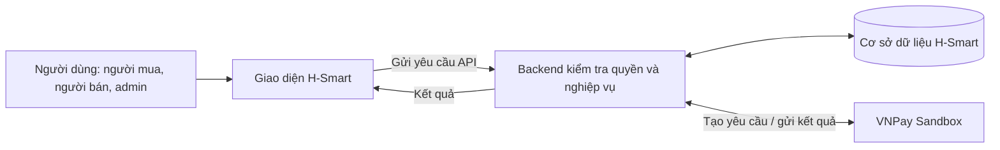
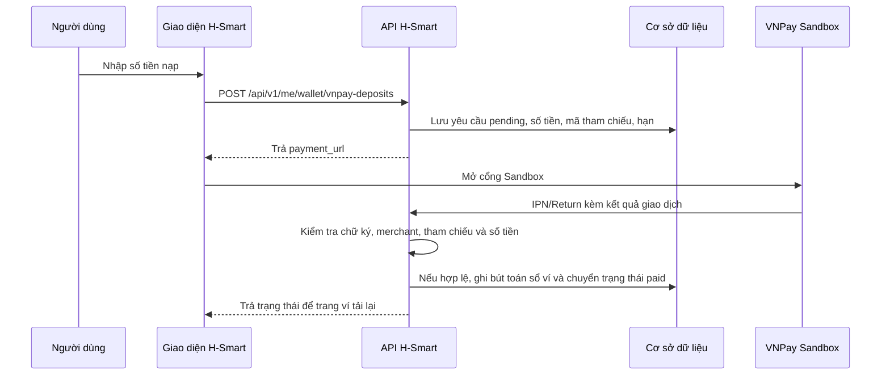
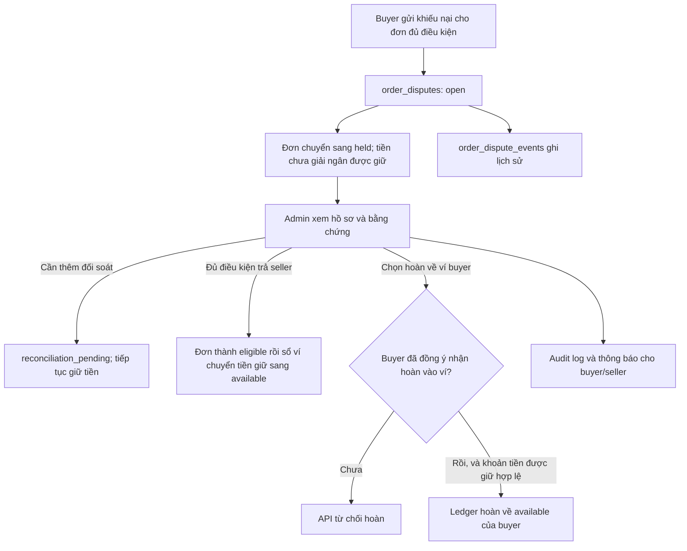

# Luồng API và dữ liệu tài chính H-Smart

> Tài liệu dành cho người muốn hiểu hệ thống hoạt động thế nào mà không cần biết lập trình. Có thể xem **API** như quầy tiếp nhận yêu cầu: giao diện gửi câu hỏi hoặc đề nghị, backend kiểm tra quyền và quy tắc, rồi mới đọc/ghi dữ liệu.

## 1. H-Smart trao đổi dữ liệu ra sao?



1. Người dùng bấm nút hoặc mở một trang.
2. Giao diện gọi API kèm phiên đăng nhập. API biết ai đang hỏi và kiểm tra người đó có quyền không.
3. Backend đọc hoặc cập nhật dữ liệu trong MySQL. Những thay đổi tiền đi qua sổ ví, không được tự cộng số dư chỉ vì giao diện báo thành công.
4. API trả kết quả để giao diện hiển thị.

Các API cá nhân cần access token đăng nhập. API quản trị cần thêm quyền admin. Các callback VNPay là trường hợp riêng: VNPay gọi về máy chủ; backend xác nhận chữ ký và giao dịch thay vì tin vào trang kết quả người dùng nhìn thấy.

## 2. Các dữ liệu chính liên quan với nhau thế nào?

```text
Tài khoản người mua ─┐
                     ├── Đơn hàng ── Sản phẩm đã mua
Tài khoản người bán ─┘      │
                            ├── Khiếu nại ── Lịch sử từng hành động
                            │
                            └── Giao dịch sổ ví ── Các dòng cộng/trừ tiền

Tài khoản ── Yêu cầu nạp VNPay ── Giao dịch sổ ví (chỉ sau callback hợp lệ)
```

| Tên dễ hiểu | Nơi lưu | Vai trò |
|---|---|---|
| Tài khoản | `users` | Xác định người mua, người bán hoặc admin. |
| Đơn hàng | `orders` | Ghi người mua, người bán, sản phẩm, trạng thái, số tiền, phí đã chốt và thông tin thanh toán. |
| Khiếu nại | `order_disputes` | Gắn với một đơn hàng; lưu lý do, mô tả, trạng thái và quyết định. |
| Lịch sử khiếu nại | `order_dispute_events` | Ghi ai làm gì và lúc nào, ví dụ mở khiếu nại hoặc đồng ý nhận hoàn. |
| Giao dịch sổ ví | `wallet_transactions` | Một lần thay đổi tiền đã được hệ thống ghi nhận, có mã tham chiếu duy nhất. |
| Dòng tiền | `wallet_entries` | Các khoản cộng/trừ tạo nên giao dịch sổ ví. Một giao dịch có nhiều dòng đối ứng; dòng thuộc nền tảng có thể không gắn với tài khoản cá nhân. |
| Yêu cầu nạp VNPay | `wallet_vnpay_deposits` | Theo dõi yêu cầu nạp riêng với đơn hàng: người nạp, số tiền, mã tham chiếu, hạn và trạng thái. |

**Ví dụ:** đơn #123 liên kết người mua, người bán và sản phẩm. Bút toán giải ngân có thể tham chiếu lại đơn #123. Nếu đơn có khiếu nại, khiếu nại cũng lưu `order_id=123`; lịch sử khiếu nại lại nối vào mã khiếu nại. Vì vậy có thể lần từ đơn đến các lần xử lý và dòng tiền liên quan.

## 3. Bốn luồng nghiệp vụ

### A. Xem doanh thu người bán hoặc admin

| Ai xem | API giao diện gọi | Backend đọc |
|---|---|---|
| Người bán | `GET /api/v1/me/wallet/revenue` | Chỉ các đơn và dòng tiền của tài khoản đang đăng nhập. |
| Admin | `GET /api/v1/admin/revenue` | Đơn đã thanh toán và các dòng doanh thu nền tảng; chỉ tài khoản admin được vào. |

Trang có thể gửi bộ lọc kỳ hạn/ngày và trang chi tiết. API trả về tổng số liệu, chuỗi cho biểu đồ và danh sách chi tiết để giao diện trình bày.

- **Doanh thu người bán** tính từ tiền hàng của đơn hoàn tất, trừ phí nền tảng và phần tiền của người bán bị đảo do hoàn. Phí vận chuyển không được cộng vào tiền hàng bán.
- **Chờ giải ngân** là khoản còn đang giữ; nó chưa phải tiền người bán đã nhận.
- **Đã ghi có vào ví** là các dòng sổ ví thực sự chuyển tiền từ `pending_release` sang `available`.
- **COD thu trực tiếp** được báo riêng vì tiền người mua trả cho người giao hàng/người bán không tự động đi qua ví H-Smart.
- **Doanh thu nền tảng** lấy từ dòng `platform_revenue` đã ghi sổ như hoa hồng, phí đăng tin, phí quảng bá, sau khi trừ dòng đảo do hoàn.
- **Giá trị hàng đã thanh toán (GMV)** không đồng nghĩa với doanh thu của nền tảng. Tiền trong ví người dùng, tiền đang giữ hộ và yêu cầu rút cũng không phải doanh thu nền tảng.

### B. Nạp ví bằng VNPay Sandbox



1. Giao diện gửi số tiền và một mã yêu cầu để chống tạo trùng. API giới hạn từ **10.000đ đến 10.000.000đ**.
2. H-Smart lưu một yêu cầu `pending` có mã tham chiếu riêng rồi trả đường dẫn Sandbox. **Lưu yêu cầu chưa làm tăng số dư ví.**
3. Người dùng thao tác ở cổng Sandbox. Khi có kết quả, VNPay gửi callback (IPN); trình duyệt cũng có thể quay lại trang H-Smart (Return).
4. Backend kiểm tra chữ ký, merchant, VND, mã tham chiếu, số tiền và mã kết quả. Trang Return chỉ đưa người dùng quay lại; bản thân việc quay lại không chứng minh đã thanh toán.
5. Chỉ callback hợp lệ mới tạo giao dịch ví: cộng vào `available` và ghi dòng đối ứng với `provider_clearing`. Callback lặp cùng giao dịch không được cộng tiền lần thứ hai.

API chính:

- `POST /api/v1/me/wallet/vnpay-deposits` — tạo yêu cầu nạp.
- `GET /api/v1/me/wallet/vnpay-deposits/{reference}` — xem trạng thái yêu cầu của chính tài khoản đó.
- `GET /api/v1/payments/vnpay/wallet/ipn` và `/api/v1/payments/vnpay/wallet/return` — điểm nhận callback/quay lại cho luồng nạp ví.

Nạp ví khác thanh toán đơn hàng: yêu cầu nạp nằm ở `wallet_vnpay_deposits`, không tạo đơn giả. Thanh toán đơn dùng `POST /api/v1/orders/{id}/payment` và luồng callback đơn hàng riêng.

### C. Ai được xem phí và tiền người bán nhận?

Giao diện lấy danh sách hoặc chi tiết đơn qua `GET /api/v1/orders` và `GET /api/v1/orders/{id}`. Backend dùng tài khoản đăng nhập để giới hạn đơn và trường dữ liệu:

- **Người mua** thấy phần cần cho giao dịch của mình như giá hàng, phí giao hàng, tổng thanh toán, thanh toán và trạng thái đơn.
- **Người bán của chính đơn đó** thấy thêm phí nền tảng, tỷ lệ hoa hồng, tiền thực nhận dự kiến và trạng thái giải ngân.
- **Quản trị viên** có thể xem phần tài chính để quản trị.

Phần tài chính người bán được tính từ ảnh chụp phí đã lưu trên đơn. Ví dụ: hàng 100.000đ, phí nền tảng 2.000đ thì tiền bán ròng là 98.000đ; phí giao hàng là khoản riêng. Người mua không được tự xem thông tin tài chính của người bán khác: backend tự quyết định có trả nhóm `seller_financials` hay không.

### D. Khiếu nại và quyết định xử lý tiền



- Người mua mở khiếu nại tại `POST /api/v1/orders/{id}/disputes`. Đơn phải được thanh toán, đang giao/hoàn tất và chưa giải ngân; mỗi đơn chỉ có thể có một khiếu nại đang mở. Khi tạo khiếu nại, đơn chuyển sang `held`.
- Người mua có thể chủ động ghi nhận đồng ý nhận hoàn vào số dư bằng `POST /api/v1/orders/{id}/disputes/refund-consent`. Đây là sự đồng ý về phương thức, chưa phải quyết định hoàn tiền.
- Quản trị viên xem danh sách tại `GET /api/v1/admin/disputes` và xử lý bằng `POST /api/v1/admin/disputes/{id}/resolve` với một trong ba lựa chọn: `manual_reconciliation` (tiếp tục chờ), `release_to_seller` (giải ngân khi đủ điều kiện), hoặc `refund_to_buyer_wallet` (hoàn vào Ví của người mua khi họ đã đồng ý và tiền có thể hoàn).
- Quyết định cập nhật khiếu nại/đơn trong một giao dịch cơ sở dữ liệu, ghi lịch sử hành động và audit log; sau đó gửi thông báo cho các bên. Không thể xử lý lại hồ sơ đã đóng.
- COD thu trực tiếp nhưng **không có tiền cọc do H-Smart giữ** không thể dùng số dư đang giữ ở đơn khác để hoàn. Trường hợp đó cần đối soát thủ công.

## 4. Cách đọc trạng thái tiền

| Từ giao diện/API | Nghĩa là |
|---|---|
| `payment_status = paid` | Hệ thống đã xác nhận phía thanh toán thu tiền cho phần thanh toán được ghi nhận. Đây chưa chắc là tiền đã vào ví seller. |
| `payout_status = held` | Phần liên quan còn bị giữ, ví dụ do khiếu nại hoặc chưa đủ điều kiện giải ngân. |
| `pending_release` | Tiền người bán được ghi nhận nhưng chưa chuyển sang số dư có thể dùng. |
| `available` | Số dư khả dụng trong Ví của tôi theo sổ giao dịch ứng dụng. Đây là số liệu của bản demo/Sandbox, không phải số dư tài khoản ngân hàng. |
| `credited_to_wallet` | Đã có bút toán chuyển tiền bán từ phần đang giữ sang ví khả dụng. |
| `refunded_to_wallet` | Đã ghi bút toán hoàn về số dư H-Smart; đây không phải chuyển tiền ra ngân hàng. |
| `pending` của yêu cầu nạp VNPay | Đang chờ kết quả; chưa cộng vào ví. |
| `reconciliation_required` | Có sai lệch hoặc callback đến muộn; cần người quản trị kiểm tra, không tự cộng tiền. |

Sổ ví luôn ghi ít nhất hai dòng đối ứng cho một thay đổi tiền và tổng các dòng bằng 0. Có thể hiểu như sổ kế toán: mỗi khoản cộng ở một nơi phải có khoản đối ứng ở nơi khác. Các số dư hiển thị được tổng hợp từ những dòng đã ghi sổ, không phải con số do giao diện tự đặt.

## 5. Danh sách API để tra cứu

| Nghiệp vụ | Endpoint | Ai được gọi |
|---|---|---|
| Xem ví của mình | `GET /api/v1/me/wallet` | Tài khoản đã đăng nhập |
| Xem doanh thu seller | `GET /api/v1/me/wallet/revenue` | Tài khoản seller đã đăng nhập |
| Xem doanh thu toàn sàn | `GET /api/v1/admin/revenue` | Admin |
| Tạo yêu cầu nạp Sandbox | `POST /api/v1/me/wallet/vnpay-deposits` | Tài khoản đã đăng nhập |
| Xem đơn của mình | `GET /api/v1/orders`, `GET /api/v1/orders/{id}` | Người tham gia đơn; admin dùng API quản trị |
| Xem đơn để quản trị | `GET /api/v1/admin/orders` | Quản trị viên |
| Mở khiếu nại | `POST /api/v1/orders/{id}/disputes` | Người mua của đơn |
| Đồng ý nhận hoàn vào ví | `POST /api/v1/orders/{id}/disputes/refund-consent` | Người mua của đơn có khiếu nại mở |
| Xem khiếu nại | `GET /api/v1/admin/disputes` | Quản trị viên |
| Xử lý khiếu nại | `POST /api/v1/admin/disputes/{id}/resolve` | Quản trị viên |

API nội bộ có thể bổ sung hoặc thay đổi theo phiên bản. Route thực tế nằm trong `backend/app/Modules/Wallet/routes/api.php`, `backend/app/Modules/Order/routes/api.php` và `backend/app/Modules/Admin/routes/api.php`.

## 6. Tệp mã nguồn nếu muốn xem chi tiết

- Quy tắc trả dữ liệu đơn và quyền xem tài chính: `backend/app/Modules/Order/Http/Resources/OrderResource.php`.
- Tổng hợp doanh thu seller/admin: `backend/app/Modules/Wallet/Http/Controllers/SellerRevenueController.php` và `backend/app/Modules/Admin/Http/Controllers/AdminRevenueController.php`.
- Tạo yêu cầu và xử lý callback nạp ví: `backend/app/Modules/Wallet/Http/Controllers/WalletVnPayController.php`, `backend/app/Modules/Wallet/Services/WalletVnPayService.php`.
- Sổ ví và cách ghi các dòng đối ứng: `backend/app/Modules/Wallet/Services/WalletLedger.php`.
- Mở khiếu nại và ghi nhận lựa chọn của buyer: `backend/app/Modules/Order/Http/Controllers/OrderDisputeController.php`.
- Danh sách và quyết định admin: `backend/app/Modules/Admin/Http/Controllers/AdminDisputeController.php`.
